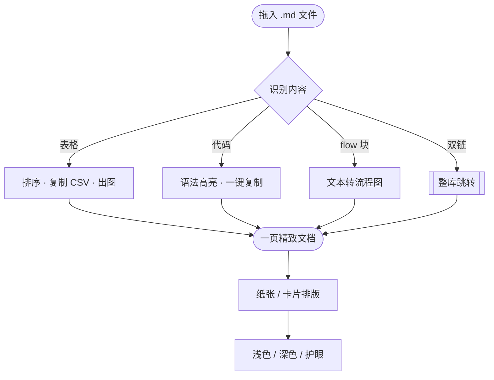

# 让 Markdown 阅读成为一种享受

> [!abstract] 这不是说明书，是一份可以边读边点的样例
>
> 文中的表格**能排序、能出图**，代码**能一键复制**，流程图**能一键转成图形**，标题**自动汇成大纲**。顺着读完这一篇，MD Reader 的核心能力你基本都亲手试过了。

**MD Reader** 是一个只有几 MB 的单文件应用：把 `.md` 拖进来，就得到一页安静、精致、可交互的文档。全程离线、不上传、不采集，再敏感的笔记也放心读。

> [!tip] 三步开始
>
> ① `Ctrl+Shift+O` 打开文件（或直接把文件 / 整个文件夹拖进窗口） → ② 左侧「文件 / 大纲 / 搜索 / 最近」自由切换 → ③ 顶栏「导出」把成果带走。

---

## 一分钟上手

### 先看这份清单

- [x] 打开单个 `.md`，或拖入文件夹直接建起一座**整库**
- [x] 用 `A− / A+` 调字号、`行高` 调行距（紧凑 / 标准 / 舒适 / 宽松），顶栏换 **浅色 / 深色 / 护眼** 三种肤色
- [x] 点任意表头排序，点「复制 CSV」把数据粘进 Excel
- [ ] 按 `Ctrl+E` 进入**按块编辑**，改完 `Ctrl+S` 保存
- [ ] 点「专注」进入沉浸阅读，按 `Esc` 回到工作台

### 常用快捷键

| 操作 | 快捷键 | 什么时候用 |
| --- | --- | --- |
| 打开文件 | `Ctrl+Shift+O` | 任意界面，支持多选 |
| 专注模式 | `Ctrl+O` | 隐去侧栏与顶栏，保留渲染快捷菜单 |
| 最近打开 | `Ctrl+R` | 接力阅读，自动回到上次位置 |
| 收起 / 展开侧栏 | `Ctrl+B` | 想给正文更多宽度时 |
| 编辑源码 | `Ctrl+E` | 按块编辑 / 整篇编辑随时切换 |
| 保存 | `Ctrl+S` | 写回原文件，换行与 frontmatter 不失真 |
| 查找 | `Ctrl+F` | 高亮命中并逐条跳转 |
| 退出专注模式 | `Esc` / `Ctrl+O` | 回到完整工作台 |
| 上 / 下一节 | `Alt+↑` / `Alt+↓` | 编辑模式里快速跳块 |

> [!info] 所有偏好都会被记住
>
> 排版、字号、行高、皮肤、应用图标、表格配色、默认图表风格、流程图开关与风格、界面语言，下次打开自动沿用；设置面板里「恢复默认」可一键回到出厂状态。

---

## 阅读的仪式感

> [!quote] 好的工具应该让人忘记工具本身，只看见内容。

| 排版 | 视觉 | 更适合 |
| --- | --- | --- |
| 📄 **纸张模式** | 描图纸面 + 页边刻度，长文一页到底 | 连续阅读、技术长文、书稿 |
| 🗂 **卡片模式** | 按标题分节成卡片，编号徽章 + 淡渐变抬头 + 同级同字号的胶囊标题 | 汇报材料、多章节手册、项目复盘 |

在顶栏「排版」下拉里切换，也可以在设置面板设成默认。卡片模式下每节左上角的 `01 / 02 / 03` 徽章会**跟随表格配色一起变色**——黑白极简是墨黑、蓝色科技是克莱因蓝、红色政商是朱红、粉色卡通是樱粉；深色皮肤下自动换成「浅底深字」，保证数字始终清晰。

> [!success] 现在就试一下
>
> 点一下任意表格工具条右侧的四个配色小圆点，再回头看本页所有卡片编号、表头与图表：它们会一起换色。

其他让眼睛舒服的细节：**大纲**自动汇总 h1–h6 点击即跳、**多标签页**并行读多篇、**阅读进度**常驻状态栏、**最近打开**记住上次位置，还有一键隐去全部工具栏的**专注模式**（`Ctrl+O` 进入、`Esc` 退出，正文左侧始终留一条竖排渲染快捷菜单，排版 / 字号 / 行高 / 肤色随时可调，不遮正文）。长文读到一半被打断？关掉软件，明天 `Ctrl+R` 接着读。

---

## 表格会说话

数据表格在 MD Reader 里不是静态的：点表头排序、`复制 CSV / TSV` 导出、右侧四套配色换肤，点「图表」就地生成 **自动 / 柱状 / 折线 / 趋势 / 环形 / 玫瑰** 六种视图。五种具体图表都按主流可视化审美重做过：柱状带垂直渐变与顶端数值，折线是平滑曲线加空心描边圆点，趋势是渐变面积图，**圆角环形图**是零描边的 ECharts 式分块（圆角扇区 + 中心总量 + 右侧占比清单），**南丁格尔玫瑰图**在此基础上把扇区按数值从小到大顺时针排列、等角变径向外辐射，花瓣感与增长感一眼可辨。参考 ECharts 示例库里最受欢迎的几种实现。打开顶栏「图表总开关」，之后每一份文档的数据表都默认展开。

### 季度经营数据 · 自动判定为柱状图

| 季度 | 订单（万元） | 收入（万元） | 回款（万元） | 经营利润（万元） | 经营现金流（万元） |
| --- | ---: | ---: | ---: | ---: | ---: |
| Q1 | 2600 | 1850 | 1620 | 225 | 110 |
| Q2 | 3050 | 2240 | 2010 | 296 | 245 |
| Q3 | 3420 | 2680 | 2530 | 372 | 368 |
| Q4 | 3860 | 3150 | 3020 | 458 | 492 |

### 十二个月趋势 · 宽表自动翻转为折线

单位：万元；列数较多时可横向滚动，图表会自动把 12 个月翻到 X 轴。

| 指标 | 1月 | 2月 | 3月 | 4月 | 5月 | 6月 | 7月 | 8月 | 9月 | 10月 | 11月 | 12月 | 合计 |
| ---- | ---: | ---: | ---: | ---: | ---: | ---: | ---: | ---: | ---: | ---: | ---: | ---: | ---: |
| 订单 | 866.67 | 866.67 | 866.66 | 1016.67 | 1016.67 | 1016.66 | 1140.00 | 1140.00 | 1140.00 | 1286.67 | 1286.67 | 1286.66 | 12930.00 |
| 收入 | 616.67 | 616.67 | 616.66 | 746.67 | 746.67 | 746.66 | 893.33 | 893.33 | 893.34 | 1050.00 | 1050.00 | 1050.00 | 9920.00 |
| 回款 | 540.00 | 540.00 | 540.00 | 670.00 | 670.00 | 670.00 | 843.33 | 843.33 | 843.34 | 1006.67 | 1006.67 | 1006.66 | 9180.00 |
| 经营利润 | 75.00 | 75.00 | 75.00 | 98.67 | 98.67 | 98.66 | 124.00 | 124.00 | 124.00 | 152.67 | 152.67 | 152.66 | 1351.00 |
| 经营现金流 | 36.67 | 36.67 | 36.66 | 81.67 | 81.67 | 81.66 | 122.67 | 122.67 | 122.66 | 164.00 | 164.00 | 164.00 | 1215.00 |

### 单指标构成 · 自动变成圆角环形图

| 功能模块 | 日均使用次数 |
| --- | ---: |
| 表格可视化 | 32 |
| 整库浏览 | 24 |
| 文本流程图 | 18 |
| 按块编辑 | 14 |
| 四格式导出 | 12 |

> [!example] 动手试试
>
> ① 点「收入（万元）」表头，看排序后图表跟着重绘 → ② 在图表上切「环形 / 玫瑰 / 面积趋势」，鼠标悬停扇区时中心会实时显示该片数值 → ③ 点四色按钮，柱子、曲线、花瓣一起换色 → ④ 点「复制 CSV」，直接粘进 Excel。

### 四格式导出对照

| 格式 | 产物 | 最适合的场景 | 样式是否带走 |
| --- | --- | --- | --- |
| 📘 **Word** | `.doc` | 交材料、走审批、给别人继续改 | ✅ 表头配色、卡片徽章、图片 · 图表按 A4 版心自适应 |
| 🌐 **HTML** | 独立 `.html` | 离线分发、存档、发同事 | ✅ 样式与图表全部内嵌 |
| 🖨 **PDF** | 打印 / 另存 | 归档、打印、正式提交 | ✅ 自动隐藏工具条 |
| 📝 **Markdown** | `.md` 源文件 | 回到笔记库继续写 | — 纯源码 |

> [!warning] 导出前的小提醒
>
> Word 采用兼容性最好的 HTML 包装格式，Word / WPS 都能直接打开；未展开的图表盒不会带进 Word，但**数据表格本身完整保留**。已展开的图表与流程图按 A4 版心等比缩放成 PNG，宽表自动锁定列宽，不会再出现图片撑出页面、中文表头竖排成单字。

---

## 代码与行内样式

### 多语言高亮，每块都有「复制」按钮

```python
def collect(devices, proto="snmpv3"):
    """采集策略示例：只取在线设备"""
    return [d.read(proto) for d in devices if d.online]
```

```javascript
const render = async (md) => {
  const html = marked.parse(md, { gfm: true });
  content.innerHTML = html;
  enhanceTables();            // 排序 / CSV / 图表
  await renderMermaid();      // 流动美化流程图
};
```

```sql
SELECT region, SUM(revenue) AS total
FROM quarterly_report
WHERE year = 2026 AND revenue > 0
GROUP BY region
ORDER BY total DESC;
```

```bash
# 本地开发：构建单文件 / 国际版
python src/build.py
python src/build.py --edition global --out dist-intl/MDReader.html
```

```json
{
  "offline": true,
  "skin": ["light", "dark", "sepia"],
  "layout": ["paper", "card"],
  "export": ["word", "html", "pdf", "md"]
}
```

```yaml
reader:
  font_size: 16
  table_theme: tech
  chart_style: auto
  flow_auto: true
  language: zh-CN
```

### 行内语法全家桶

**加粗**、*斜体*、~~删除线~~、`marked.parse()` 行内代码、[外部链接](https://www.workbuddy.cn)、以及自动识别的 #标签 都正常渲染。

1. 有序列表第一项
2. 有序列表第二项
   - 嵌套无序子项 A
   - 嵌套无序子项 B
     - 第三级依然层次分明

> 引用可以只放一句金句，也可以继续嵌套：
>
> > 嵌套引用，用在注脚与出处特别顺手。

> [!question] 数学公式支持吗？
>
> 当前版本未内置公式引擎，LaTeX 会以源码显示；表格、图表、流程图、双链这些更高频的场景已经做深做透。

---

## 双引擎流程图

### 原生 Mermaid，自动获得流动质感



圆角节点、渐变描边与沿线流水动效由内置的 **MD FLOW** 渲染器统一施加，原生 Mermaid 语法无需任何改写。

> [!tip] 五套流程图风格 · 长节点自动竖向
>
> 设置 →「流程图风格」可即时切换 **经典 / 极简 / 商务 / 活力 / 暗夜**：画布、节点、连线、编号徽章与阴影一起变，导出 Word / HTML 与屏幕完全一致。节点文字过长会自动折行，横向图太宽会自动改成自上而下的竖向布局，不必手动把 `graph LR` 改成 `graph TD`。

### 符号空格文本流程图 · 一键转图形

```flow
@main LR
([导入]) --> [预校验门禁] --> [任务执行] --> {人工裁决} --> ![归档]
[预校验门禁] -- WARN 放行 --> ![留痕告警]
[预校验门禁] -- FAIL --> ![硬隔离]
[任务执行] -- 重试 3 次 / 间隔 5m --> [重试队列] --> ![重试留痕终态]
@sub
{人工裁决} -. 依赖触发 .-> [分类路由]
[分类路由] -- 确认 --> ![通过归档]
[分类路由] -- 驳回 --> ![驳回留痕]
[分类路由] -- SLA超时 --> ![超时升级]
```

> [!note] 两种写法都认
>
> 除了 `[节点] --> [节点]`，也支持 `① 已导入 → ② 待校验 → ③ 校验通过` 这样的 ①②③ 符号占位与 `⇒` 箭头，甚至能画回环。点顶栏「流程图」总开关，整篇一次性转换；再点一次还原源码。

```flow
@main LR
① 已导入 → ② 待校验 → ③ 校验通过 → ④ 已准入
② 待校验 → WARN 校验告警 → 人工放行 → ④ 已准入
② 待校验 → FAIL 校验失败 → 已隔离 →（修正重传）→ ② 待校验
```

---

## Obsidian 知识库友好

拖入整个 Vault，文件树、大纲、全文搜索立刻可用；UTF-8 / GB18030 自动识别，相对路径图片也能正常显示。

- 双链跳转：[[项目总览]]、[[项目总览|别名写法]]、[[采集策略#SNMP v3]]
- 图片嵌入：打开所在文件夹后，相对路径图片会正常显示（写法见下一节）
- 标签：#智慧综维 #数字员工 #IPOSS
- YAML 属性：就是本文开头的 `---` 区块，会渲染成可折叠的「📋 文档属性」

### Callout 提示块全家桶

> [!note] 笔记
>
> 适合补充说明、随手记下的背景信息，不打断主线。

> [!info] 信息
>
> 中性事实与口径说明，配一枚蓝色信息标。

> [!success] 成功
>
> 结论、已完成项、验证通过的结果。

> [!question] 问题
>
> 把待确认的疑问单独拎出来， review 时一眼能看到。

> [!warning] 警告
>
> 需要留意的边界条件，比如编码、路径、导出差异。

> [!danger] 危险
>
> 不可逆操作、数据丢失风险，用最高优先级标出来。

> [!example] 示例
>
> 一段可照抄的用法，或一组演示数据。

> [!todo] 待办
>
> 下一步要做什么，和任务列表配合使用。

> [!quote] 引用
>
> 金句、出处、访谈原文，与正文拉开层次。

### 图片嵌入的两种写法

```text
![[assets/demo.svg|320]]        ← Obsidian 嵌入，管道符控制宽度
            ← 标准 Markdown 图片
```

把整个文件夹拖进窗口后，这两种写法的本地图片都会正确解析；只打开单个 `.md` 时可能显示为缺图占位。

### 编码与路径

> [!warning] 编码提示
>
> UTF-8 与 GB18030 会自动识别；打开整个文件夹时，`![[图片]]` 与相对路径图片都能正常显示。只打开单个文件时，本地图片可能显示为缺图占位，这是预期行为。

---

## 整库浏览与按块编辑

| 能力 | 怎么用 | 解决什么 |
| --- | --- | --- |
| 📁 文件树 | 拖入文件夹，左侧按目录展开 | 上千篇笔记不用导出来回折腾 |
| ☷ 大纲 | 切到「大纲」标签，点标题即跳 | 长文定位不再靠滚动条 |
| 🔍 全文搜索 | 输入关键词，按文件分组列命中 | 只记得一句话也能找回来 |
| ✎ 按块编辑 | `Ctrl+E`，左栏选段落 / 标题 / 表格 / 代码 | 不再把整篇塞进一个文本框乱序 |
| 💾 写回原文件 | `Ctrl+S`，或「全篇编辑」切换 | 换行、空行、frontmatter 分毫不差 |
| 🕘 最近打开 | `Ctrl+R`，自动恢复阅读位置 | 接力阅读零成本 |

> [!tip] 按块编辑的正确姿势
>
> 左栏每个块带类型标签与字数：`H` 标题、`¶` 段落、`•` 列表、`▦` 表格、`</>` 代码、`❝` 引用、`―` 分隔线。用「↑ 上块 / ↓ 下块」连续走查，比在长文本里找光标快得多。

---

## 三个典型场景

1. **读一份季度经营分析**：拖入 `.md` → 表格自动出图 → 切「蓝色科技」配色 → 点表头按收入排序 → 「复制 CSV」贴进 Excel → 导出 Word 交材料。
2. **翻自己的 Obsidian 库**：拖入 Vault 根目录 → 用全文搜索找关键词 → 点 [[双链]] 在库内跳转 → 切「护眼」肤色 + 专注模式长读 → `Ctrl+R` 明天接着读。
3. **给团队发一份离线手册**：切「卡片」排版 → 打开图表总开关 → 转好流程图 → 导出独立 HTML（样式图表全部内嵌）→ 一个文件发群里，断网也能看。

> [!success] 一个文件，覆盖全链路
>
> 从打开、阅读、可视化、编辑，到 Word / HTML / PDF / Markdown 交付，MD Reader 不依赖网络、不依赖服务端，也不需要安装任何运行时。

---

## 写在最后

> [!quote] 所谓「享受」，不过是每次想做的事，都刚好在手边。

如果某个细节还不够顺手，欢迎来信吐槽：📩 **527400412@qq.com**。公众号「**晨曦AI研习**」回复 `MDReader` 可获取更新、源码与技术分享。

---

*MD Reader · 免费开源 · 让 Markdown 阅读成为一种享受 · 本文既是使用指南，也是一份可直接编辑的 Markdown 样例。*
