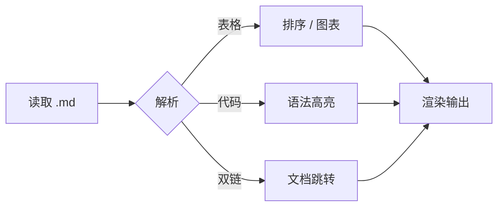
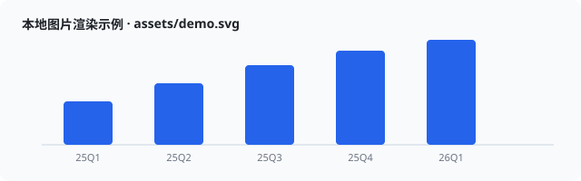

# MD Reader · 功能演示

> [!tip] 这是一份示例文档
> 打开自己的 `.md` 文件，或把整个文件夹拖进窗口即可开始阅读。全程本地运行，不联网、不上传。

## 1. 表格可视化

| 季度 | 采集节点(个) | 告警量(条) | 处理时长(分钟) |
| --- | ---: | ---: | ---: |
| 2025 Q1 | 1200 | 860 | 42 |
| 2025 Q2 | 1450 | 730 | 38 |
| 2025 Q3 | 1780 | 610 | 31 |
| 2025 Q4 | 2100 | 480 | 25 |
| 2026 Q1 | 2350 | 390 | 21 |

👆 点击表格右上角的「**图表**」生成柱状图；点击**表头**可排序；「复制 CSV」可直接粘进 Excel。数值列会自动右对齐。

## 2. 代码块与语法高亮

```python
def collect(devices, proto="snmpv3"):
    # 采集策略示例
    return [d.read(proto) for d in devices if d.online]

nodes = collect(iposs_nodes)
print(f"online: {len(nodes)}")
```

```sql
SELECT city, COUNT(*) AS nodes
FROM   tab_city
WHERE  status = 'ONLINE'
GROUP  BY city
ORDER  BY nodes DESC;
```

行内代码 `marked.parse()`、**加粗**、*斜体*、~~删除线~~ 均正常渲染。

## 3. 任务列表与引用

- [x] 支持 GFM 表格与斑马纹
- [x] 支持代码高亮与一键复制
- [x] 支持 Mermaid 流程图
- [ ] 支持 LaTeX 数学公式（暂未内置 KaTeX）

> 好的工具应该让人忘记工具本身，只看见内容。

## 4. Mermaid 流程图



## 5. Obsidian 适配

内部双链：[[示例文档]]、[[示例文档|别名写法]]、[[示例文档#1. 表格可视化]]

标签：#智慧综维 #数字员工 #IPOSS

> [!warning] 编码与图片
> UTF-8 与 GB18030 会自动识别；打开**整个文件夹**时，相对路径图片、双链跳转都能正常工作。

> [!danger] 注意
> 单独打开一个文件时，浏览器出于安全限制拿不到它所在的目录，因此相对路径图片可能无法加载。建议直接打开文件夹。

## 6. 图片



## 7. 层级标题与大纲

### 7.1 左侧「大纲」标签页

点击右侧「☷ 大纲」可看到本文档全部标题，点击即跳转。

#### 7.1.1 更深的层级

支持到 h6，搜索框支持文档内查找与计数。

---

*点工具栏「导出」可生成带完整样式与图片的独立 HTML；「打印」可另存为 PDF。*
