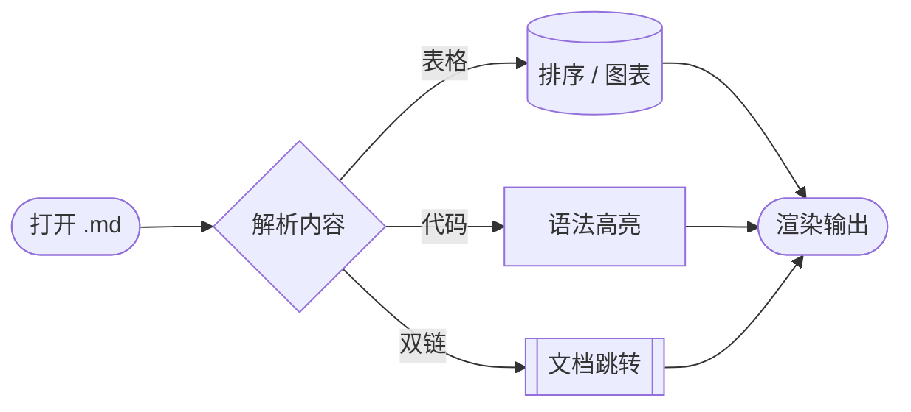

# MD Reader · 功能演示

> [!tip] 这是一份示例文档
> 打开自己的 `.md` 文件，或把整个文件夹拖进窗口即可开始阅读。全程本地运行，不联网、不上传。

## 1. 表格可视化

### 1.1 西南区域季度经营数据（绝对数）

| 季度 | 订单（万元） | 收入（万元） | 回款（万元） | 经营利润（万元） | 经营现金流（万元） |
| --- | ---: | ---: | ---: | ---: | ---: |
| Q1 | 2600 | 1850 | 1620 | 225 | 110 |
| Q2 | 3050 | 2240 | 2010 | 296 | 245 |
| Q3 | 3420 | 2680 | 2530 | 372 | 368 |
| Q4 | 3860 | 3150 | 3020 | 458 | 492 |

### 1.2 环比与回款质量

| 季度 | 订单环比 | 收入环比 | 回款环比 | 经营利润环比 | 经营现金流环比 | 回款 / 收入比（回款质量） | 利润率（经营利润 / 收入） |
| --- | ---: | ---: | ---: | ---: | ---: | ---: | ---: |
| Q1 | - | - | - | - | - | 87.57% | 12.16% |
| Q2 | +17.31% | +21.08% | +24.07% | +31.56% | +122.73% | 89.73% | 13.21% |
| Q3 | +12.13% | +19.64% | +25.87% | +25.68% | +50.20% | 94.40% | 13.88% |
| Q4 | +12.87% | +17.54% | +19.37% | +23.12% | +33.70% | 95.87% | 14.54% |

👆 点击表格右上角的「**图表**」生成柱状图；点击**表头**可排序；「复制 CSV」可直接粘进 Excel。数值列会自动右对齐。工具条右侧还能切换 **黑白极简（默认）/ 蓝色科技 / 红色政商 / 粉色卡通** 四套表格风格，选择会自动记住。

## 2. 代码块与语法高亮

```python
def collect(devices, proto="snmpv3"):
    # 采集策略示例
    return [d.read(proto) for d in devices if d.online]

nodes = collect(iposs_nodes)
print(f"online: {len(nodes)}")
```

```sql
SELECT city, COUNT(*) AS nodes
FROM   tab_city
WHERE  status = 'ONLINE'
GROUP  BY city
ORDER  BY nodes DESC;
```

行内代码 `marked.parse()`、**加粗**、*斜体*、~~删除线~~ 均正常渲染。

## 3. 任务列表与引用

- [x] 支持 GFM 表格与斑马纹
- [x] 支持代码高亮与一键复制
- [x] 支持 Mermaid 流程图
- [ ] 支持 LaTeX 数学公式（暂未内置 KaTeX）

> 好的工具应该让人忘记工具本身，只看见内容。

## 4. Mermaid 流程图



### 4.1 符号空格文本型流程图（一键转换）

@//md-render-hint/
# 范式类型：GATE-PIPELINE + HETEROGENEOUS-STATE-MACHINE
# 范式释义：串行门禁流水线 + 同事件异构分流状态子机
# 布局模式：LR（横向） / TD（纵向）
# 分组规则：
#   GROUP-MAIN：主线流水线，主色，实线流转；节点遵循门禁模型：导入→预校验门禁→任务执行→人工裁决→归档；支持软告警放行、硬失败隔离、重试、生命周期衍生分支
#   GROUP-SUB：分流状态子机，辅助色；由主线某节点【虚线依赖触发】；基于分类路由，多分支共享事件（确认/驳回/SLA超时），但后置动作、统计口径、权限隔离
# 流转强约束（渲染器静态校验，渲染时标红违规连线）
#   1. 状态单向流转，禁止终态回退连线
#   2. 同一父节点下，确认/驳回/超时 互斥分支，不允许合并回待审
#   3. WARN告警 = 软门禁旁路；FAIL = 硬隔离，不可直通下一阶段
#   4. 重试节点必须标注重试次数+间隔，重试终点为留痕终态
# 视觉规则
#   GROUP-MAIN 填充色：#e8f8f0 描边 #239955
#   GROUP-SUB 填充色：#fff6e0 描边 #dd9922
#   实线：强制流转；虚线：依赖触发关系（不是流程跳转）
# 自动附加组件：自动生成图例、状态矩阵附表、文件输出清单
# 导出配置：输出SVG矢量图；导出时附带配套说明文本；支持嵌入hover备注
# 语义校验开关：ON，渲染前自动检查是否违反范式约束并输出警告
@//end-md-render-hint/

👆 点顶栏「**流程图**」按钮，把整篇文档的文本流程图一键转成图形；再点一次还原源码。

```flow
@main LR
([导入]) --> [预校验门禁] --> [任务执行] --> {人工裁决} --> ![归档]
[预校验门禁] -- WARN 放行 --> ![留痕告警]
[预校验门禁] -- FAIL --> ![硬隔离]
[任务执行] -- 重试 3 次 / 间隔 5m --> [重试队列] --> ![重试留痕终态]
[预校验门禁] -- FAIL --> [越级放行] // FAIL 未隔离，故意保留用于演示违规标红
@sub
{人工裁决} -. 依赖触发 .-> [分类路由]
[分类路由] -- 确认 --> ![通过归档]
[分类路由] -- 驳回 --> ![驳回留痕]
[分类路由] -- SLA超时 --> ![超时升级]
```

## 5. Obsidian 适配

内部双链：[[示例文档]]、[[示例文档|别名写法]]、[[示例文档#1. 表格可视化]]

标签：#智慧综维 #数字员工 #IPOSS

> [!warning] 编码与图片
> UTF-8 与 GB18030 会自动识别；打开**整个文件夹**时，相对路径图片、双链跳转都能正常工作。

> [!danger] 注意
> 单独打开一个文件时，浏览器出于安全限制拿不到它所在的目录，因此相对路径图片可能无法加载。建议直接打开文件夹。

## 6. 图片


## 7. 层级标题与大纲

### 7.1 左侧「大纲」标签页

点击右侧「☷ 大纲」可看到本文档全部标题，点击即跳转。

#### 7.1.1 更深的层级

支持到 h6，搜索框支持文档内查找与计数。

---

*点工具栏「导出」可生成带完整样式与图片的独立 HTML；「打印」可另存为 PDF。*
