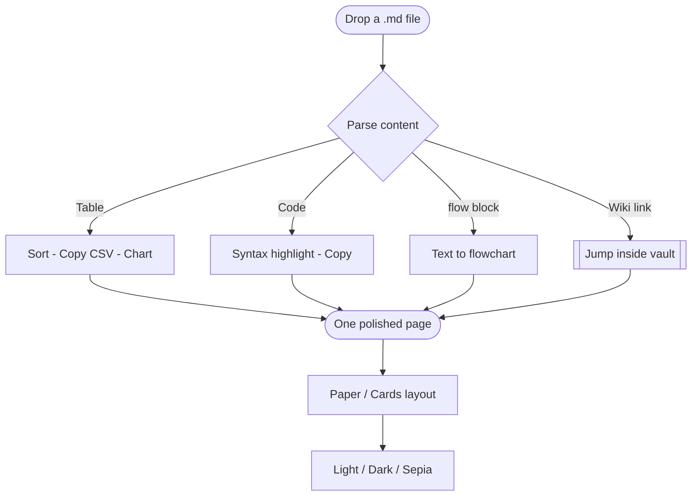

# Make Markdown reading a pleasure

> [!abstract] Not a manual - a sample you can click as you read
>
> The tables below **sort and draw charts**, every code block **copies in one click**, flowcharts **turn into diagrams instantly**, and headings **build the outline automatically**. By the time you finish this page, you will have tried nearly every core feature of MD Reader.

**MD Reader** is a single file just a few MB in size. Drop in a `.md` file and you get a quiet, polished, interactive page. Fully offline, nothing uploaded, nothing collected - even sensitive notes are safe to read.

> [!tip] Get started in three steps
>
> ① Press `Ctrl+Shift+O` to open a file (or drop a file / an entire folder into the window) → ② Switch between **Files / Outline / Search / Recent** on the left → ③ Use **Export** in the toolbar to take your work with you.

---

## The first minute

### A quick checklist

- [x] Open a single `.md`, or drop a folder to build a **whole library**
- [x] Adjust type size with `A- / A+` and line spacing with `Line Height` (Tight / Standard / Comfortable / Loose), switch **Light / Dark / Sepia** skins
- [x] Click any table header to sort, use **Copy CSV** to paste into Excel
- [ ] Press `Ctrl+E` for **block editing**, then `Ctrl+S` to save
- [ ] Enter **Focus mode** for distraction-free reading, `Esc` to return

### Keyboard shortcuts

| Action | Shortcut | When to use |
| --- | --- | --- |
| Open file | `Ctrl+Shift+O` | Anywhere, multiple selection supported |
| Focus mode | `Ctrl+O` | Hide sidebars and toolbar, keep the render quick menu |
| Recent files | `Ctrl+R` | Resume reading at your last position |
| Toggle sidebar | `Ctrl+B` | When the text needs more room |
| Edit source | `Ctrl+E` | Switch between block editing and full-document editing |
| Save | `Ctrl+S` | Write back to the original file, line breaks preserved |
| Find | `Ctrl+F` | Highlight matches and jump through them |
| Exit focus mode | `Esc` / `Ctrl+O` | Return to the full workspace |
| Previous / next block | `Alt+Up` / `Alt+Down` | Fast navigation while editing |

> [!info] Every preference is remembered
>
> Layout, type size, line height, skin, app icon, table colors, default chart style, flowchart switch and style, and UI language all persist across sessions. **Restore defaults** in Settings takes you back to a clean slate.

---

## The ritual of reading

> [!quote] A good tool makes you forget the tool and see only the content.

| Layout | Look and feel | Best for |
| --- | --- | --- |
| 📄 **Paper** | Tracing-paper surface with page-edge ticks, one continuous sheet | Long reads, technical articles, book drafts |
| 🗂 **Cards** | Sections become cards with numbered badges, soft gradient headers and same-size pill headings per level | Reports, multi-chapter manuals, retrospectives |

Switch from the **Layout** dropdown in the toolbar, or set a default in Settings. In Cards mode the `01 / 02 / 03` badges **follow the table color theme** - ink black for Mono, Klein blue for Tech, vermilion for Official, cherry pink for Playful. On the dark skin they flip to a light badge with dark numerals so they stay legible.

> [!success] Try it right now
>
> Click one of the four color dots on the right of any table toolbar, then look back at the section badges, table headers and charts on this page: they all change together.

A few more details that keep your eyes happy: the **Outline** collects h1-h6 headings for one-click jumps, **tabs** let several documents stay open, a **reading progress** indicator lives in the status bar, **Recent** remembers where you stopped, and **Focus mode** (`Ctrl+O` to enter, `Esc` to exit) hides every toolbar at once while a vertical render quick menu on the left keeps layout, type size, line height and theme within reach without covering the text. Interrupted halfway through a long piece? Close the app and press `Ctrl+R` tomorrow.

---

## Tables that talk

A data table in MD Reader is never static: click a header to sort, use **Copy CSV / TSV** to export, switch between four color themes, and press **Chart** for **Auto / Bar / Line / Trend / Donut / Rose** views. All five are drawn to a mainstream visualization aesthetic: gradient rounded bars with value labels, smooth lines with hollow marker dots, a gradient area chart, a **rounded donut chart** with zero strokes (rounded slices, centered total, share list on the right), and a **Nightingale rose chart** whose sectors are sorted small-to-large clockwise and radiate outward with value-scaled radii for the petal look. Inspired by the most popular ECharts examples. Turn on the global **Charts** switch and every data table in every document opens with its chart expanded.

### Quarterly results - auto-detected as a bar chart

| Quarter | Orders (k CNY) | Revenue (k CNY) | Cash In (k CNY) | Operating Profit (k CNY) | Operating Cash Flow (k CNY) |
| --- | ---: | ---: | ---: | ---: | ---: |
| Q1 | 2600 | 1850 | 1620 | 225 | 110 |
| Q2 | 3050 | 2240 | 2010 | 296 | 245 |
| Q3 | 3420 | 2680 | 2530 | 372 | 368 |
| Q4 | 3860 | 3150 | 3020 | 458 | 492 |

### Twelve-month trend - wide tables flip to a line chart

All values in k CNY; scroll horizontally for the full year, and the chart flips the 12 months onto the X axis.

| Metric | Jan | Feb | Mar | Apr | May | Jun | Jul | Aug | Sep | Oct | Nov | Dec | Total |
| ---- | ---: | ---: | ---: | ---: | ---: | ---: | ---: | ---: | ---: | ---: | ---: | ---: | ---: |
| Orders | 866.67 | 866.67 | 866.66 | 1016.67 | 1016.67 | 1016.66 | 1140.00 | 1140.00 | 1140.00 | 1286.67 | 1286.67 | 1286.66 | 12930.00 |
| Revenue | 616.67 | 616.67 | 616.66 | 746.67 | 746.67 | 746.66 | 893.33 | 893.33 | 893.34 | 1050.00 | 1050.00 | 1050.00 | 9920.00 |
| Cash In | 540.00 | 540.00 | 540.00 | 670.00 | 670.00 | 670.00 | 843.33 | 843.33 | 843.34 | 1006.67 | 1006.67 | 1006.66 | 9180.00 |
| Profit | 75.00 | 75.00 | 75.00 | 98.67 | 98.67 | 98.66 | 124.00 | 124.00 | 124.00 | 152.67 | 152.67 | 152.66 | 1351.00 |
| Cash Flow | 36.67 | 36.67 | 36.66 | 81.67 | 81.67 | 81.66 | 122.67 | 122.67 | 122.66 | 164.00 | 164.00 | 164.00 | 1215.00 |

### A single metric - automatically a rounded donut chart

| Feature | Daily uses |
| --- | ---: |
| Table visualization | 32 |
| Library browsing | 24 |
| Text flowcharts | 18 |
| Block editing | 14 |
| Four export formats | 12 |

> [!example] Hands-on
>
> ① Click the **Revenue** header and watch the chart redraw → ② Switch that chart to **Donut / Rose / Area trend**; hovering a slice shows its value in the center in real time → ③ Click a color dot: bars, curves and petals recolor together → ④ Press **Copy CSV** and paste straight into Excel.

### Export formats compared

| Format | Output | Best for | Keeps styling |
| --- | --- | --- | --- |
| 📘 **Word** | `.doc` | Hand-offs, reviews, further editing | ✅ Header colors, section badges, images · charts fit the A4 text area |
| 🌐 **HTML** | Standalone `.html` | Offline sharing, archiving | ✅ All styles and charts embedded |
| 🖨 **PDF** | Print / Save as PDF | Archiving, printing, formal delivery | ✅ Toolbars hidden automatically |
| 📝 **Markdown** | `.md` source | Continue writing in your vault | — Plain source |

> [!warning] Before you export
>
> Word uses the most compatible HTML-wrapper format, openable directly in Word and WPS. Collapsed chart boxes are skipped, but **the data table itself is always kept**. Expanded charts and flowcharts are scaled to the A4 text area as PNGs, and wide tables get fixed column widths - no more images spilling off the page or Chinese headers squeezed into one character per line.

---

## Code and inline styles

### Multi-language highlighting, every block with a Copy button

```python
def collect(devices, proto="snmpv3"):
    """Sample collection policy: online devices only"""
    return [d.read(proto) for d in devices if d.online]
```

```javascript
const render = async (md) => {
  const html = marked.parse(md, { gfm: true });
  content.innerHTML = html;
  enhanceTables();            // sort / CSV / charts
  await renderMermaid();      // animated flowcharts
};
```

```sql
SELECT region, SUM(revenue) AS total
FROM quarterly_report
WHERE year = 2026 AND revenue > 0
GROUP BY region
ORDER BY total DESC;
```

```bash
# Local build: single file and international edition
python src/build.py
python src/build.py --edition global --out dist-intl/MDReader.html
```

```json
{
  "offline": true,
  "skin": ["light", "dark", "sepia"],
  "layout": ["paper", "card"],
  "export": ["word", "html", "pdf", "md"]
}
```

```yaml
reader:
  font_size: 16
  table_theme: tech
  chart_style: auto
  flow_auto: true
  language: en
```

### The inline syntax family

**Bold**, *italic*, ~~strikethrough~~, `marked.parse()` inline code, an [external link](https://www.workbuddy.cn), and auto-detected #tags all render correctly.

1. First ordered item
2. Second ordered item
   - Nested bullet A
   - Nested bullet B
     - A third level stays perfectly aligned

> A quote can hold a single line, or nest another quote:
>
> > Nested quotes work nicely for sources and footnotes.

> [!question] Are math formulas supported?
>
> No formula engine is bundled in this version, so LaTeX stays as source. The higher-frequency cases - tables, charts, flowcharts and wiki links - are the ones we have pushed deepest.

---

## Two flowchart engines

### Native Mermaid, with animated flow styling



Rounded nodes, gradient strokes and flowing line animation come from the built-in **MD FLOW** renderer - plain Mermaid syntax needs no changes at all.

> [!tip] Five flowchart styles - long nodes go vertical automatically
>
> Settings > **Flowchart Style** switches instantly between **Classic / Minimal / Business / Vivid / Neon**: canvas, nodes, links, numbered badges and shadows all change together, and Word / HTML exports match the screen exactly. Overlong node labels wrap automatically, and a diagram too wide for the page is redrawn top-down - no need to edit `graph LR` into `graph TD` by hand.

### Symbol-and-space text flowcharts - convert in one click

```flow
@main LR
([Import]) --> [Pre-check gate] --> [Run task] --> {Human review} --> ![Archive]
[Pre-check gate] -- WARN pass --> ![Warning logged]
[Pre-check gate] -- FAIL --> ![Quarantine]
[Run task] -- retry 3 times / 5m apart --> [Retry queue] --> ![Retry logged]
@sub
{Human review} -. triggers .-> [Classify route]
[Classify route] -- Approve --> ![Approved]
[Classify route] -- Reject --> ![Rejected]
[Classify route] -- SLA timeout --> ![Escalated]
```

> [!note] Both notations are accepted
>
> Besides `[Node] --> [Node]`, you can write `1 Imported -> 2 Pending -> 3 Verified` with circled-number placeholders and arrow symbols, including loops. Press the global **Flowcharts** switch in the toolbar to convert the entire document at once; press again to restore the source.

```flow
@main LR
① Imported → ② Pending → ③ Verified → ④ Admitted
② Pending → WARN Warning → Manual pass → ④ Admitted
② Pending → FAIL Failed → Quarantined → (Fix and resend) → ② Pending
```

### A third way: plain arrows in a sentence

One line of text is enough for a small state chain: `Draft → Review → Approved → Published`. Enclose a group of those lines in a `flow` code block and MD Reader turns them into a clean diagram.

---

## Obsidian vault friendly

Drop in an entire vault and the file tree, outline and full-text search are ready immediately. UTF-8 and GB18030 are detected automatically, and relative image paths resolve correctly.

- Wiki links: [[Project Overview]], [[Project Overview|Alias]], [[Collection Policy#SNMP v3]]
- Image embeds: relative images resolve once you open the folder (syntax in the next section)
- Tags: #knowledge #vault #markdown
- YAML properties: the `---` block at the top of this page, rendered as a collapsible **Document properties** panel

### The callout family

> [!note] Note
>
> Background details and side remarks that should not interrupt the main thread.

> [!info] Info
>
> Neutral facts, definitions and measurement conventions.

> [!success] Success
>
> Conclusions, completed items and verified results.

> [!question] Question
>
> Open questions, separated so they stand out during review.

> [!warning] Warning
>
> Conditions worth checking: encoding, paths, export differences.

> [!danger] Danger
>
> Irreversible actions and data-loss risks, at the highest priority.

> [!example] Example
>
> A snippet you can copy verbatim, or a set of demo data.

> [!todo] To do
>
> The next step, to be used alongside task lists.

> [!quote] Quote
>
> A memorable line, a citation or interview text, visually set apart.

### Two ways to embed an image

```text
![[assets/demo.svg|320]]        - Obsidian embed, pipe sets the width
            - Standard Markdown image
```

Drop the whole folder into the window and both forms resolve correctly. Opening a single standalone `.md` may show a placeholder instead.

### Encoding and paths

> [!warning] Encoding note
>
> UTF-8 and GB18030 are detected automatically. When you open a whole folder, `![[image]]` embeds and relative image paths work; opening a single standalone file may show a placeholder for local images, which is expected.

---

## Library browsing and block editing

| Capability | How to use it | What it solves |
| --- | --- | --- |
| 📁 File tree | Drop a folder, expand directories on the left | Thousands of notes without exporting anything |
| ☷ Outline | Switch to the Outline tab, click a heading | No more hunting with the scrollbar |
| 🔍 Full-text search | Type a keyword, matches grouped by file | Find a note when you remember only one sentence |
| ✎ Block editing | `Ctrl+E`, pick a heading / paragraph / table / code block | No more one giant textarea with shuffled sections |
| 💾 Write back | `Ctrl+S`, or switch to full-document editing | Line breaks, blank lines and frontmatter preserved |
| 🕘 Recent files | `Ctrl+R`, restores your reading position | Zero-cost resume |

> [!tip] The right way to use block editing
>
> Each block in the left pane carries a type badge and word count: `H` heading, `P` paragraph, `L` list, `T` table, `C` code, `Q` quote, `R` rule. Walking through them with **Previous / Next** is far faster than hunting for a caret in a long document.

---

## Three everyday scenarios

1. **Read a quarterly business review**: drop in the `.md` → charts expand automatically → switch to the **Tech** blue theme → sort by revenue → **Copy CSV** into Excel → export Word for the hand-off.
2. **Browse your own Obsidian vault**: drop in the vault root → search a keyword → follow [[wiki links]] between notes → switch to **Sepia** plus Focus mode for a long read → `Ctrl+R` tomorrow.
3. **Send the team an offline handbook**: switch to **Cards** → turn on the global Charts switch → convert the flowcharts → export a standalone HTML with all styles and charts embedded → share one file that works with no network.

> [!success] One file, the whole chain
>
> From opening, reading, visualizing and editing to Word / HTML / PDF / Markdown delivery, MD Reader needs no network, no server and no runtime installation.

---

## One last note

> [!quote] Pleasure is simply having the thing you want to do right where your hand already is.

If something still feels clumsy, send a note: 📩 **527400412@qq.com**.

---

*MD Reader - free and open source - Make Markdown reading a pleasure - This page is both a user guide and an editable Markdown sample.*
