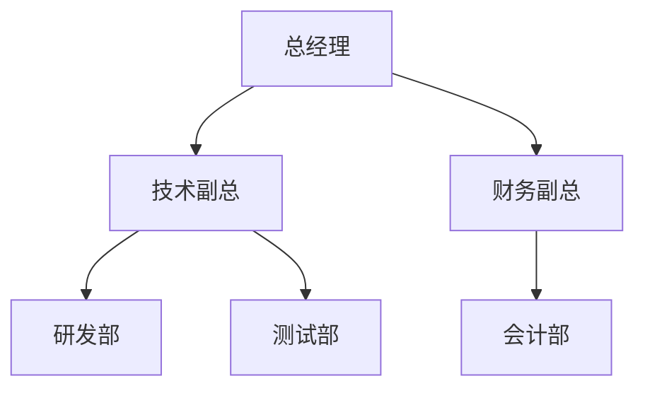
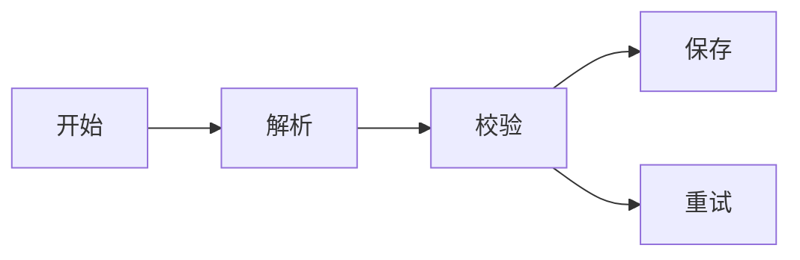

# 统一文档风格与单图结构验证

## 数据概览

| 季度 | 营收 | 成本 |
| --- | --- | --- |
| Q1 | 120 | 80 |
| Q2 | 150 | 95 |
| Q3 | 180 | 110 |

## 代码片段

```js
const total = 120;
function sum(a, b) {
  return a + b;
}
```

## 流程图 A · 组织架构



## 流程图 B · 处理链路


