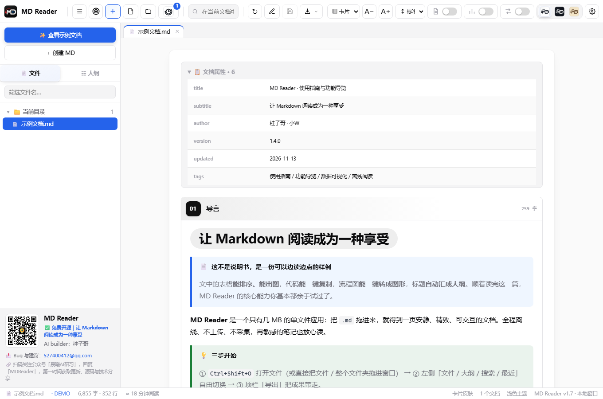
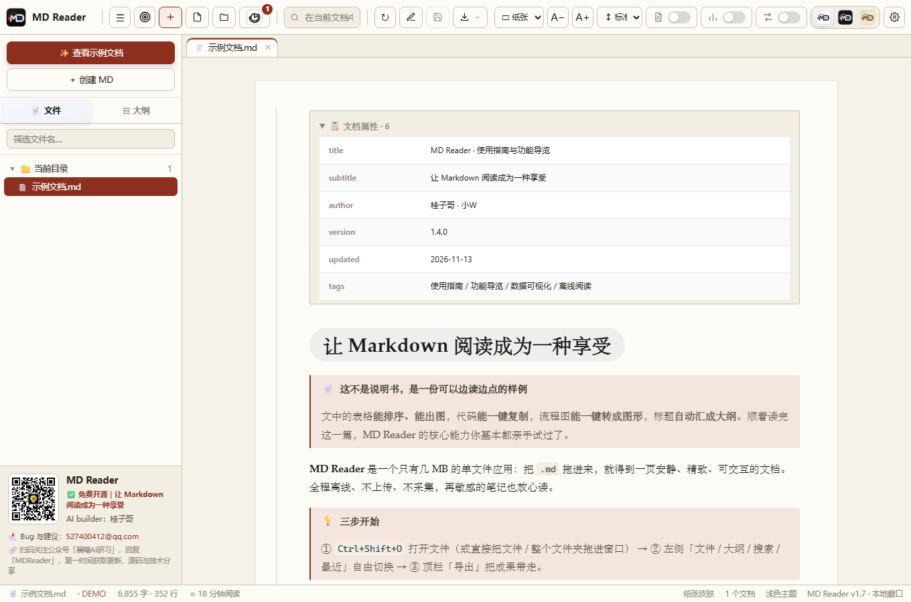
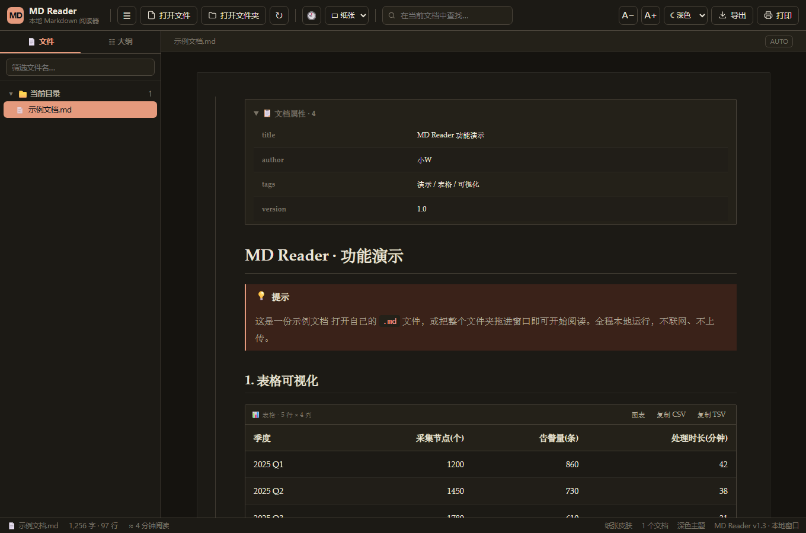
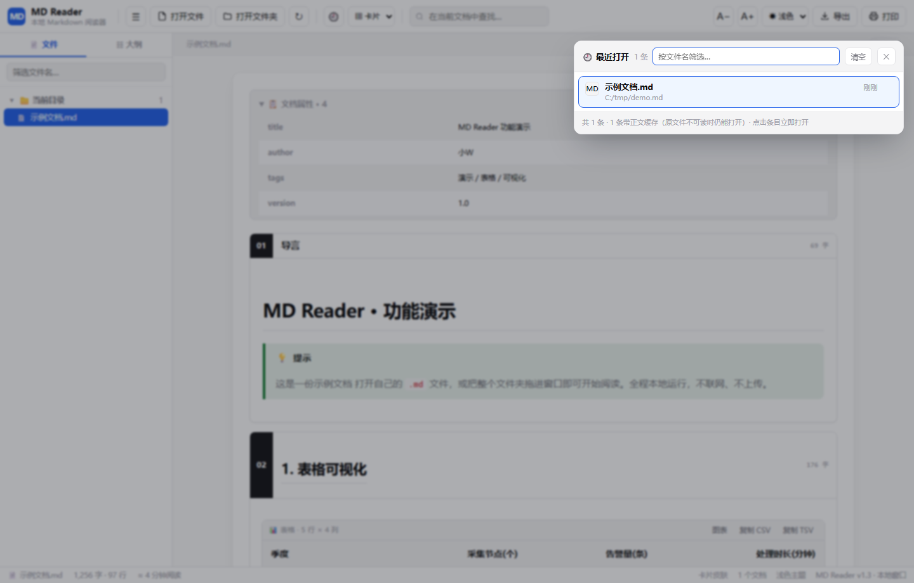
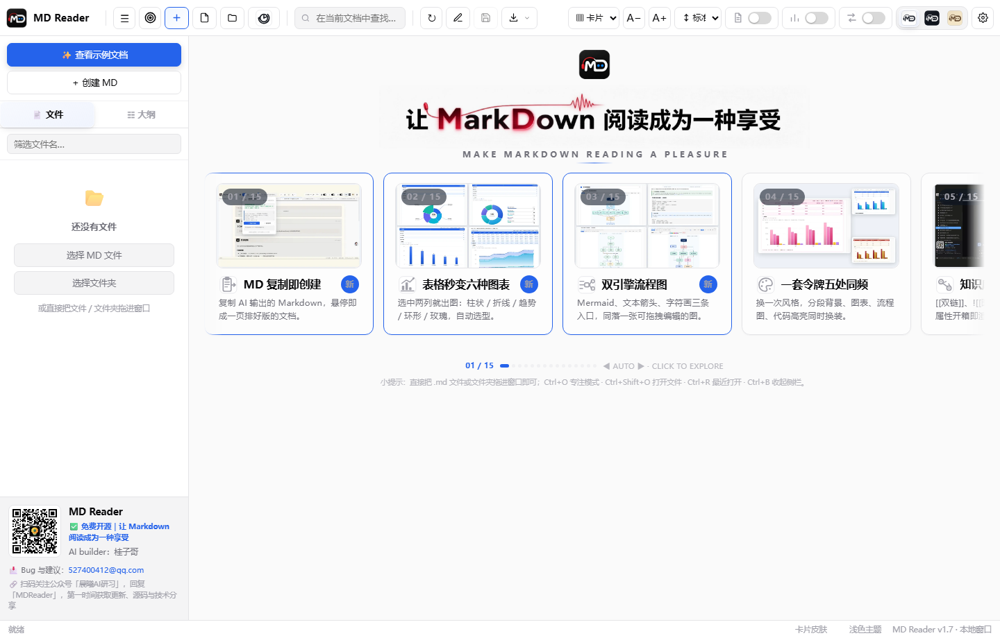

# MD Reader

**English** · [简体中文](README.md)

> **A local Markdown reader that opens the moment you double-click a `.md` file — no IDE, no browser tab, and no uploading internal documents to an online editor.**

[](https://github.com/guizige-890323/mdreader/releases)
[](https://github.com/guizige-890323/mdreader/releases)
[](https://github.com/guizige-890323/mdreader/stargazers)
[](LICENSE)
[](https://github.com/guizige-890323/mdreader/releases)
[](#privacy--security)

**One HTML file is the whole application.** marked, highlight.js and Mermaid are inlined at build time, and the running program makes zero network requests.

<p align="center">
  
</p>

<!-- TODO(demo): record a 20-second walkthrough (open → switch skins → sort a table → chart → dark theme),
     save as docs/screenshots/demo.gif, then replace this comment. The GIF must sit above the fold. -->

**Contents:** [Why this exists](#why-this-exists) · [Three ways to run it](#three-ways-to-run-it) · [What makes it different](#what-makes-it-different) · [Features](#features) · [Screenshots](#screenshots) · [Install](#install) · [Platform support](#platform-support) · [How it compares](#how-it-compares) · [FAQ](#faq) · [Build from source](#build-from-source) · [Repository layout](#repository-layout) · [Privacy & security](#privacy--security) · [Version & roadmap](#version--roadmap) · [Contributing](#contributing) · [License](#license)

---

## Why this exists

| Situation | What people usually do | The problem | MD Reader |
| --- | --- | --- | --- |
| Just read one `.md` file | Open VS Code / Obsidian | Slow startup, needs a vault, needs plugins | Double-click, standalone window |
| Ops runbooks, incident guides | Drop them into an online Markdown editor | Internal documents leave the network — a compliance risk | Parsed entirely on your machine |
| Documents with wide tables | Plain preview pane gives you a static table | No sorting, no way to see the shape of the data | Click-to-sort headers + one-click bar chart |
| 1,100+ Obsidian notes | Import the whole vault first | Heavy, slow | Drag a folder in, lazy tree, instant open |
| Long runbooks with many sections | Scroll to the bottom | Lose your place | Card skin numbers every `##` section |
| The doc you had open yesterday | Dig through folders again | Breaks your flow | Recents list re-reads from disk |

---

## Three ways to run it

| | Portable | Desktop installer | iOS / iPadOS (PWA) |
| --- | --- | --- | --- |
| Artifact | `MDReader-Windows11便携版.zip` (~2.9 MB) | `MD Reader Setup 1.3.0.exe` (NSIS, ~112 MB) | `MDReader-iOS-PWA.zip` (~2.3 MB) |
| Install | None — unzip and run | Double-click, choose a directory | Serve over LAN, then "Add to Home Screen" |
| Desktop entry | Manual shortcut | **Desktop + Start Menu, created automatically** | ✅ Home screen icon, full-screen launch |
| `.md` association | Manual "Open with" | **Registers 4 extensions, can be set as default** | ❌ iOS forbids third-party default handlers |
| Double-click to open | Via a launcher `.bat` | Native single instance, hands the path to the running window | ❌ Pick the file inside the app |
| Size | Tiny | Large (bundles the Electron runtime) | Small (same HTML + icons + manifest) |
| Best for | USB sticks, temp machines, air-gapped networks | Your everyday machine | Reading `.md` on iPhone / iPad |

> All three share the same `MDReader.html` — the rendering behaviour is identical, there is no "lite" build.
> iOS has no "desktop" concept and does not let third-party apps register global file handlers. On desktop the counterpart is **macOS**, and the build configuration is already in the repo. See [`docs/PLATFORM.md`](docs/PLATFORM.md) for the full capability matrix.

---

## What makes it different

Most Markdown viewers stop at "render the syntax". Three pieces here go further:

**A custom Mermaid renderer (MD FLOW).** Instead of accepting Mermaid's default purple theme, `src/mermaid-flow.js` parses `flowchart` source itself and re-lays it out: longest-path ranking, six passes of barycenter crossing reduction, port fan-out, cubic Bézier edges, back-edge U-channels, numbered badges, and a colour accent per rank. A dashed "flow" layer animates along every edge at a constant pixel speed. Unsupported syntax falls back to stock Mermaid automatically — no blank diagrams, ever.

**Plain text in, diagram out.** Write a flow with arrows and symbols (`→`, `⇒`, `①②③`, `[box]`, `{decision}`) inside a ```` ```flow ```` fence and one click turns the whole document's flows into diagrams — and one more click puts the text back.

**A table theme system.** Four visual themes (mono / tech / gov / cute) applied consistently to headers, zebra rows, numerics, and the generated charts, each adapting to all three colour themes.

---

## Features

### Rendering & visualization

| Area | Support |
| --- | --- |
| Base syntax | GFM tables, headings, lists, task lists, blockquotes, rules, bold/italic, strikethrough, inline code, links, images |
| Tables | Zebra striping, hover highlight, sticky header, **click-to-sort**, numeric columns auto right-aligned, **one-click bar chart**, copy as CSV / TSV |
| Code | Syntax highlighting for 40+ languages, language label, copy button |
| Diagrams | ```` ```mermaid ```` flowcharts / sequence / gantt, themed to match the app |
| Obsidian | `[[wikilinks]]`, `![[image embeds]]`, `[!note]` callouts, YAML frontmatter property tables, `#tag` highlighting |

### Two layout skins

Not just a border swap — colours, type, radii, shadows, tables and code blocks all change together.

| | ▥ Card | ▭ Paper |
| --- | --- | --- |
| Canvas | Light grey `#fafafa` | Warm cream `#f5f2ea` |
| Surface | Pure white, 12 px radius, layered soft shadow | Ivory `#fdfbf6`, 2 px radius, no shadow |
| Headings | System sans-serif | Serif (Iowan / Georgia) |
| Accent | Blue `#2563eb` | Deep red `#8c2f1e` |
| Structure | One card per `##` section, numbered `01` / `02` with word count | Continuous prose with a bound margin rule |
| Best for | Runbooks, checklists, reference docs | Long-form reading, reports, print preview |

Both skins support **light / dark / sepia** independently of the skin, so you get 2 × 3 combinations. Sepia is a genuinely low-blue-light warm tone (card `#faf3e0`, paper `#fdf3d8`), visibly different from the plain light theme. Outline and anchor jumps keep working in card mode — heading `id`s are preserved.

### Reading & files

- **Recents** — up to 30 entries; opening one **re-reads the file from disk** rather than showing a stale snapshot, and falls back to the cached copy if the file has moved
- Folder tree (recursive), document outline, in-document search with match count and next/prev, font size control
- Drag a file or an entire folder; UTF-8 / GB18030 encoding detection; 1,000+ file vaults via lazy loading
- Export a **standalone HTML** (styles and images inlined), print, or save as PDF

---

## Screenshots

| Card skin (light) | Paper skin (light) |
| --- | --- |
|  |  |

| Card skin (dark) | Paper skin (dark) |
| --- | --- |
|  |  |

| Recents | Welcome screen |
| --- | --- |
|  |  |

---

## Install

### Windows desktop (recommended)

1. Download `MD Reader Setup 1.3.0.exe` from [Releases](https://github.com/guizige-890323/mdreader/releases)
2. Run it — installs for the current user, no admin rights required
3. It creates a **Desktop** shortcut and a **Start Menu** entry automatically
4. Double-click any `.md`; if the app is already running, the file opens in the existing window

> The installer registers `.md` / `.markdown` / `.mdown` / `.mkd`, writes both `OpenWithProgids` and `Applications\MD Reader.exe\SupportedTypes` (so the app actually shows up under "Choose another app"), and gives the extensions a dedicated document icon in Explorer.

### Make it the default `.md` handler

**Windows 11**

1. Right-click any `.md` → **Open with** → **Choose another app**
2. Pick **MD Reader** → tick **Always use this app** → OK
3. Or: Settings → Apps → Default apps → choose by file type → `.md` → MD Reader

**macOS**

Select a `.md` in Finder → `⌘I` → **Open with** → MD Reader → **Change All…**

### Portable (no install)

Unzip `MDReader-Windows11便携版.zip` anywhere (USB stick included) and run `启动 MDReader.bat`.

You can also drag a `.md` onto `用此程序打开MD.bat`, or associate either `.bat` through "Open with".

> Requires Microsoft Edge, which ships with Windows 11, for the chrome-less app window. Opening the raw HTML in a browser works too — you just get an address bar.

### iOS / iPadOS (PWA — what iOS actually allows)

Unzip `MDReader-iOS-PWA.zip`, then in that folder run `python -m http.server 8000 --bind 0.0.0.0`. On your iPhone/iPad, open `http://<your-lan-ip>:8000/` in Safari → **Share** → **Add to Home Screen**. You get a full-screen, chrome-less "MD Reader" icon; pick files with **Open file** from the Files app.

> This is the closest thing to a home-screen app that iOS permits. It **cannot** register a `.md` default handler or open files on double-click. Details in `docs/PLATFORM.md`.

### macOS

Source and build configuration live in `MDReader/desktop/`. The `.dmg` **must be built on macOS** (Apple code signing and `iconutil`), see [`MDReader/desktop/README.md`](MDReader/desktop/README.md).

---

## Platform support

| Capability | Windows 11 | macOS 11+ | iOS / iPadOS |
| --- | --- | --- | --- |
| Desktop icon after install | ✅ | ✅ (Dock / Applications) | ✅ Home screen (PWA — iOS has no desktop) |
| Registered as default `.md` handler | ✅ | ✅ | ❌ Not permitted for third-party apps |
| Receives external `.md` files | ✅ double-click / CLI | ✅ double-click / drop on Dock | ⚠️ In-app picker; Share Sheet needs a native app |
| Offline, zero network requests | ✅ | ✅ | ✅ (Service Worker cache when served over HTTPS) |
| Status in this repo | ✅ Installer shipped | ✅ Same source + build scripts | ⚠️ PWA shipped, not a native app (Electron has no iOS target) |

**On iOS:** the system only offers `CFBundleDocumentTypes`, which makes an app appear in "Open with" — and the user must pick it every time. Electron does not target iOS at all; a native build would mean a separate SwiftUI + WKWebView project. This repo ships the PWA, and does not pretend otherwise. See [`docs/PLATFORM.md`](docs/PLATFORM.md).

---

## How it compares

If you write long-form Markdown every day, this is not your main tool — **editing only goes as far as "fix a line or two"** (block editing plus `Ctrl+S` writing back to the original file; no syntax-highlighted editor, no plugins). It mainly solves **reading a local document that already exists.**

| Your situation | Use instead | Why |
| --- | --- | --- |
| You need to write Markdown | Typora | WYSIWYG writing is the benchmark of this category |
| 1,000+ notes, backlinks and a graph | Obsidian | The knowledge base is its core; MD Reader only renders that layer |
| Reading README files while coding | VS Code | You are already in it |
| Real-time collaboration or cloud sync | Notion / Google Docs | MD Reader deliberately has no accounts and no sync |
| Documents containing math | Something else | **No KaTeX / MathJax support — a real gap** |
| Just reading a local `.md` without opening an editor | **MD Reader** | Double-click, zero network, section cards, sortable tables |

Full 16-dimension comparison (Typora / Obsidian / MarkText / VS Code / online editors): **[docs/COMPARISON.md](docs/COMPARISON.md)**.

---

## FAQ

| Question | Answer |
| --- | --- |
| Can it edit? | Yes — block editing plus `Ctrl+S` writes back to the original file; but it is not a primary writing tool |
| Is it really fully offline? | Yes, and you can verify it yourself with grep plus an unplugged cable |
| Does a 3.8 MB HTML file open slowly? | Cold start is roughly 0.4–0.8 s; it is a local file with no network round-trip |
| Why is the Windows installer over 100 MB? | The portable build (1.3 MB) is usually enough; the installer bundles the Electron runtime |
| Does it run on macOS? | It does, but you must compile it — the maintainer has not tested it on a Mac |
| Why do some diagrams ignore the dark theme? | Advanced syntax is handed back to stock Mermaid on purpose — a deliberate fallback |

All 17 questions (encoding, image paths, iOS limits, PDF export): **[docs/FAQ.md](docs/FAQ.md)**.

---

## Build from source

```bash
git clone https://github.com/guizige-890323/mdreader.git
cd mdreader/MDReader/desktop

npm install                 # Electron + electron-builder
npm run icons               # generate app/file icons (optional, already committed)
npm run build:win           # → desktop/release/MD Reader Setup 1.3.0.exe
# on macOS: npm run build:mac → .dmg
```

The portable and iOS bundles need no Node at all:

```bash
python src/build.py                    # regenerate the single-file MDReader.html
python src/pack.py                     # → MDReader-Windows11便携版.zip
python MDReader/ios/build-pwa.py       # → MDReader-iOS-PWA.zip
```

> **Changing the icon means re-packaging everything.** `npm run icons` regenerates the ICO, NSIS wizard bitmaps and in-app logo from `brand-source/`; after that you must run `src/build.py` → `sync-app.py` → `build:win` → `pack.py` → `ios/build-pwa.py` in order. Editing the images in `build/` alone leaves the shipped installer and portable zip with the old icon. Full checklist: [`docs/PLATFORM.md`](docs/PLATFORM.md).

Behind a slow connection to GitHub, use mirrors for the Electron binaries:

```bash
export ELECTRON_MIRROR="https://npmmirror.com/mirrors/electron/"
export ELECTRON_BUILDER_BINARIES_MIRROR="https://npmmirror.com/mirrors/electron-builder-binaries/"
npm install
```

**Rendering-layer changes only** (`src/template.html`, `src/app.js`) rebuild like this, and update the desktop and portable builds together:

```bash
python src/build.py                          # → dist/MDReader.html
python desktop/scripts/sync-app.py           # sync into the Electron shell
python desktop/scripts/verify-portable.py    # 17-check regression
python src/pack.py                           # re-pack the portable zip
```

---

## Repository layout

```
mdreader/
├── README.md                    Chinese README
├── README.en.md                 ← this file
├── LICENSE                      MIT + third-party appendix
├── CHANGELOG.md                 release history (single source of truth)
├── CONTRIBUTING.md              contribution guide
├── CODE_OF_CONDUCT.md           Contributor Covenant 2.1
├── SECURITY.md                  vulnerability disclosure
├── .editorconfig                indentation / newline conventions
├── .gitattributes               line endings and binary rules
├── .gitignore
├── .github/
│   ├── ISSUE_TEMPLATE/          bug / feature forms + config.yml
│   ├── PULL_REQUEST_TEMPLATE.md
│   ├── dependabot.yml           dependency scanning
│   └── workflows/ci.yml         syntax check, build, drift check, regression
├── docs/
│   ├── screenshots/             6 UI screenshots
│   ├── PLATFORM.md              capability matrix across three platforms
│   ├── FAQ.md                   17 answers (limits / size / privacy / encoding)
│   ├── COMPARISON.md            16-dimension comparison with Typora / Obsidian / MarkText / VS Code
│   ├── RELEASE.md               release process, release-note template, repo metadata
│   └── THIRD-PARTY-LICENSES.md  bundled dependency licenses
└── MDReader/
    ├── dist/                    portable build (committed artifact)
    │   ├── MDReader.html        the whole app, 3.8 MB single file
    │   ├── 启动 MDReader.bat
    │   ├── 用此程序打开MD.bat
    │   ├── open-with.ps1
    │   ├── 示例文档.md / assets/
    │   └── 使用说明.md
    ├── src/                     source
    │   ├── template.html        UI + both skins' CSS
    │   ├── app.js               all application logic
    │   ├── mermaid-flow.js      custom Mermaid renderer (MD FLOW)
    │   ├── text-flow.js         plain-text → diagram
    │   ├── vendor/              marked / hljs / mermaid, offline
    │   ├── build.py             inline dependencies → single HTML
    │   └── pack.py              portable packaging
    ├── tools/                   icon generation / screenshots / browser checks
    ├── desktop/                 Electron installer
    │   ├── main.js              single instance / associations / menu / encoding
    │   ├── preload.js           contextBridge allow-list
    │   ├── app/                 ← generated by sync-app.py from dist/, not committed
    │   ├── build/               icons + NSIS fragments + offline rcedit
    │   ├── scripts/             sync / icons / regression checks
    │   └── release/             ← build output (.exe / .dmg), not committed
    └── ios/                     iOS / iPadOS PWA
        ├── build-pwa.py         inject manifest / icons → site + zip
        └── site/                ← generated, not committed
```

`dist/` **is** committed: after editing anything under `src/`, run `python MDReader/src/build.py` and commit the regenerated artifact, or CI's drift check will fail. `desktop/app/`, `desktop/release/` and `ios/site/` are produced by scripts and never committed.

---

## Privacy & security

- **Zero network requests.** marked 15, highlight.js 11 and Mermaid 10 are inlined; there is no `fetch` to any external origin in the source.
- **Nothing is uploaded.** Documents are parsed inside your local browser / Electron renderer process.
- **No registry pollution** (portable): the `.bat` launcher writes only a local `_autoload.js`. Delete the folder to uninstall.
- **Desktop hardening:** `nodeIntegration: false`, `contextIsolation: true`, and a `contextBridge` allow-list. External links are handed to your default browser.
- Recents and theme preferences stay in `localStorage` (portable) or `%APPDATA%\mdreader` (desktop). Nothing syncs across devices.

Found a security issue? Please read [`SECURITY.md`](SECURITY.md) before opening a public issue.

---

## Version & roadmap

See [CHANGELOG.md](CHANGELOG.md). Current release: **v1.3.0**.

| Planned | Status |
| --- | --- |
| Card / Paper skins + recents | ✅ v1.3.0 |
| Windows installer + `.md` association + desktop icon | ✅ v1.3.0 |
| macOS `.dmg` build configuration | ✅ Config ready, must be compiled on a Mac |
| Cross-document full-text search | 💡 Under evaluation |
| Product UI localisation (i18n for the interface itself) | 🔜 Planned |
| iOS document-type registration (Share Sheet) | 🔜 Needs a native SwiftUI project |

---

## Contributing

Issues and pull requests are welcome — please read [CONTRIBUTING.md](CONTRIBUTING.md) and [CODE_OF_CONDUCT.md](CODE_OF_CONDUCT.md) first.

## License

[MIT](LICENSE). Third-party dependency licenses: [`docs/THIRD-PARTY-LICENSES.md`](docs/THIRD-PARTY-LICENSES.md).

---

## Follow along (Chinese)

Release notes, source walkthroughs and technical write-ups are published first on the WeChat account **「晨曦AI研习」**. Reply `MDReader` to get download links for all three builds plus a 30-second quick start.

<p align="center">
  
</p>

---

## Star History

<a href="https://star-history.com/#guizige-890323/mdreader&Date">
  
</a>

---

**If this saved you a few IDE launches, a ⭐ Star is the cheapest way to say thanks** — and it is the only metric I watch. Found a bug? Use the [issue template](.github/ISSUE_TEMPLATE/bug_report.yml). Solo project, so replies may take a day or two, but every issue gets read.
