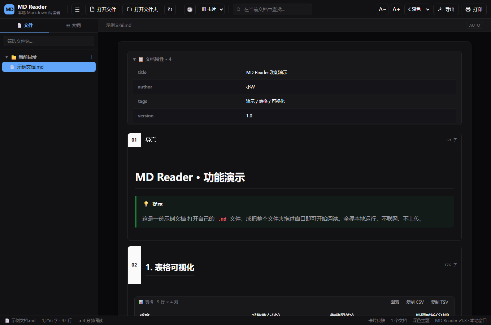

# MD Reader

**English** · [简体中文](README.md)

> **A local Markdown reader that opens on double-click. One 4.6 MB HTML file. No install, no network, no account.**

[](LICENSE)
[](docs/PLATFORM.md)
[](#privacy--security)
[](#why-is-it-so-small)

<p align="center">
  
</p>

**Contents**: [Why](#why-it-exists) · [Five builds](#five-builds) · [Features](#-features) · [Screens](#screens) · [How to run it now](#how-to-run-it-now) · [Platforms](#platform-support) · [Vs. alternatives](#how-it-compares) · [FAQ](#faq) · [Build from source](#build-from-source) · [Layout](#repository-layout) · [Privacy](#privacy--security) · [Roadmap](#version--roadmap) · [License](#contributing--license)

---

## Why it exists

Every Markdown tool is racing to become everything: accounts, cloud sync, AI summaries, plugin markets. **MD Reader goes the other way — it only does *reading*, and it does it well.**

| | What it is | What it isn't |
| --- | --- | --- |
| **Small** | One 4.6 MB HTML file, dependencies inlined | Not a 100 MB Electron bundle (the installer is a separate option) |
| **Opinionated** | No accounts, no sync, no telemetry, no built-in AI | Doesn't pretend to be universal; gaps are listed under [Platforms](#platform-support) |
| **Designed** | 2 layouts × 3 themes × 4 document styles, each fully redrawn | Not a border swap marketed as a "theme" |
| **Considerate** | Comfortable contrast, no ads, no popups, no tracking | Never trades your documents for anything |

The problems it actually solves:

| Situation | Usual approach | The catch | MD Reader |
| --- | --- | --- | --- |
| Just read one `.md` | Open VS Code / Obsidian | Slow start, vault setup, plugins | Double-click, own window |
| Runbooks / incident guides | Paste into an online editor | Internal docs leave the network | Parsed locally, 0 requests |
| Wide tables | Static preview | No sorting, no trends | Sort by column, six chart types |
| 1,100+ Obsidian notes | Import the whole vault | Heavy, slow | Drop a folder, lazy-loaded tree |
| Long manuals with many sections | Scroll forever | Can't find anything | Card layout numbers each `##` |
| Architecture diagrams in code blocks | Read the ASCII art | Can't edit or export | Detected into editable vector diagrams |

---

## Five builds

| | Portable | Windows installer | Win unpacked | iOS / iPadOS | International |
| --- | --- | --- | --- | --- | --- |
| Artifact | `MDReader-便携版-v1.7.0.zip` | `MD Reader Setup 1.7.0.exe` | `MDReader-Win免安装-v1.7.0.zip` | `MDReader-iOS-PWA-v1.7.0.zip` | `MDReader-International-v1.7.0.zip` |
| Size | ≈1.7 MB | ≈115 MB | ≈155 MB | ≈2.4 MB | ≈3.7 MB |
| Install | Unzip | Double-click | Unzip | Serve locally, "Add to Home Screen" | Unzip |
| Desktop entry | Create manually | Automatic (desktop + Start menu) | Manual | Home screen icon, full screen | Manual |
| `.md` association | "Open with" manually | Registers 4 extensions, can be default | Manual | ❌ not allowed by iOS | Manual |
| Default language | 简体中文 | 简体中文 | 简体中文 | 简体中文 | English |
| Best for | USB sticks, air-gapped machines | Daily driver | No install, native window | Phone / tablet | English environments |

> **All five share exactly one `MDReader.html`.** There is no "lite edition".
> The Chinese and International builds differ by **one line** (`BUILD_DEFAULT_LANG`) — byte-identical otherwise, enforced by the build script.
> Capability boundaries: [`docs/PLATFORM.md`](docs/PLATFORM.md).

---

## ✨ Features

### Rendering & visualization

| Area | Support |
| --- | --- |
| Basics | GFM tables, headings, lists, task lists, quotes, rules, bold/italic, strikethrough, inline code, links, images |
| Tables | Zebra rows, hover highlight, sticky header, click-to-sort, right-aligned numerics, copy as CSV / TSV |
| **Charts (6)** | Auto / bar / line / trend area / donut pie / rose. Pie slices are exactly `value/total×360°`, never equal-split |
| Code | 40+ languages, language labels, one-click copy |
| Mermaid | Flowcharts, sequence diagrams, Gantt — follows the light/dark theme |
| **Unicode diagrams** | `┌─┐│└┘` architecture diagrams inside code blocks become **draggable, editable, exportable** vector flowcharts (pure algorithm, no AI, no network) |
| **Text flowcharts** | `A → B → C` arrow text becomes a real diagram, also editable |
| Obsidian | `[[wikilinks]]`, `![[embeds]]`, `[!note]` callouts, YAML frontmatter tables, `#tags` highlighted |

### Flowcharts: structure × style × editing, three independent axes

| Axis | Options | What it changes |
| --- | --- | --- |
| **Structure** | Auto / Pipeline / Mind map / Org chart / Timeline | How nodes are laid out — **overridable per diagram** from its own toolbar |
| **Style** | Classic / Minimal / Business / Vivid / Neon | Colour and strokes only, never the layout |
| **Editing** | Drag / rename / recolour / add / delete / connect / undo | Edits land directly on the live SVG DOM |

5 structures × 5 styles = **25 looks**. Every export (SVG, regenerated Mermaid source, HTML, Word, print-to-PDF) uses the **last edited state** — exports clone the DOM instead of re-rendering, so nothing reverts.

### Typography: 2 layouts × 3 themes × 4 document styles

| | ▥ Card | ▭ Paper |
| --- | --- | --- |
| Canvas | Light grey `#fafafa` | Warm beige `#f5f2ea` |
| Sheet | White, 12 px radius, soft double shadow | Ivory `#fdfbf6`, 2 px radius, flat |
| Headings | System sans | Serif (Iowan / Georgia / Song) |
| Accent | Blue `#2563eb` | Deep red `#8c2f1e` |
| Structure | One card per `##` section, numbered `01`/`02` + word count | Continuous text with a letterpress margin rule |

Three themes (light / dark / **eye-care**) are orthogonal to layout. Eye-care is a low-blue warm beige — visibly different from plain white.

Four **document styles** (mono / tech / gov / cute) drive section backgrounds, card badges, the chart palette, flowchart accents and code syntax colours together, with readable variants derived per theme. The whole document has one mood instead of one coloured block.

### Languages

Simplified Chinese / English / follow-system, persisted. **Your own `.md` files are never translated.** The International build simply defaults to English.

### Reading & files

- **Recent files**: up to 30, re-read from the absolute path on disk (not a stale snapshot)
- Folder tree, outline, in-document search with match count, font size, reading width
- Drop a file or a whole folder; UTF-8 / GB18030 auto-detected; 1,000+ files lazy-loaded
- **New MD**: blank document, or paste Markdown copied from an AI chat; `Ctrl+S` saves a real `.md`
- Export standalone **HTML** (styles and images inlined, works offline), Word, print / save as PDF

---

## Screens

| Card · light | Paper · light |
| --- | --- |
|  |  |

| Card · dark | Paper · dark |
| --- | --- |
|  |  |

| Recent files | Welcome screen |
| --- | --- |
|  |  |

---

## How to run it now

**This repository currently ships source and build scripts only. Prebuilt packages are not open for download yet.**

Three ways to use it today, none of which require waiting:

```bash
# 1. Fastest: open the prebuilt single file in a browser
#    The built artifact is committed, so this works right after clone
MDReader/dist/MDReader.html

# 2. Portable zip (launchers + sample documents)
cd MDReader && python tools/pack-portable.py

# 3. Windows installer (needs Node 18+)
cd MDReader/desktop && npm install && npm run build:win
```

> Want the prebuilt packages the moment they open? **Star the repo** — release activity shows up in your feed.

---

## Platform support

| Capability | Windows 11 | macOS 11+ | iOS / iPadOS |
| --- | --- | --- | --- |
| Desktop icon after install | ✅ | ✅ (Dock / Applications) | ✅ Home screen icon (PWA) |
| Register as default `.md` handler | ✅ | ✅ | ❌ iOS forbids third-party global handlers |
| Receive external `.md` | ✅ double-click / CLI | ✅ double-click / drag to Dock | ⚠️ pick inside the app; share sheet needs a native app |
| Offline, zero requests | ✅ | ✅ | ✅ (Service Worker cache when served over HTTPS) |
| Shipped by this repo | ✅ installer | ✅ same source + build script | ⚠️ PWA bundle, not a native app |

**About iOS**: there is no "desktop shortcut" or system-wide default-handler mechanism. This repo ships the most honest thing possible — a PWA with a home-screen icon. See [`docs/PLATFORM.md`](docs/PLATFORM.md).

---

## How it compares

If you write long documents every day, this is not your main tool — **editing goes as far as "fix one line"** (block editing + `Ctrl+S` writes back). It exists for **reading** documents that already exist.

| Need | Better choice | Why |
| --- | --- | --- |
| Write documents | Typora | Best-in-class WYSIWYG |
| 1,000+ notes, backlinks, graph | Obsidian | The vault is the product |
| Read README while coding | VS Code | You're already there |
| Collaboration / cloud sync | Feishu / Notion | MD Reader deliberately has no accounts |
| Math formulas | Something else | **No KaTeX / MathJax — a real gap** |
| Read local `.md` without an editor | **MD Reader** | Double-click, offline, sectioned cards, sortable tables with charts |

Among comparable projects, MarkText (64k★), Logseq (45k★), SingleFile (23k★) and HedgeDoc (7.5k★) are **AGPL**; Zettlr and VNote are **GPL / LGPL**. **MD Reader is MIT** — it can be embedded in commercial or internal tooling without a licensing conversation.

Full 16-dimension comparison: **[docs/COMPARISON.md](docs/COMPARISON.md)**.

---

## FAQ

| Question | Answer |
| --- | --- |
| Can I edit? | Yes — block editing + `Ctrl+S`, but it's not a writing tool |
| Really zero network? | Yes. grep the source, then pull the network cable |
| 4.6 MB — slow to open? | Cold start ≈ 0.4–1.0 s; it's a local file |
| Why 0.8 MB bigger than v1.3? | Added an i18n bundle, the Unicode diagram engine, an export runtime and 15 welcome-screen images |
| Why is the installer 100+ MB? | Electron ships a Chromium runtime. The portable build is 1.7 MB |
| macOS? | Yes, but you must build it yourself |
| Does diagram detection need AI or network? | Neither. Pure JS, display-column grid |

More: **[docs/FAQ.md](docs/FAQ.md)**.

---

## Build from source

```bash
git clone https://github.com/guizige-890323/mdreader.git
cd mdreader

# Single file (no Node required)
python MDReader/src/gen-demo.py                          # sample docs → app.js + two .md files
python MDReader/src/build.py                             # → MDReader/dist/MDReader.html (Chinese default)
python MDReader/src/build.py --edition global \
    --out MDReader/dist-intl/MDReader.html               # → International (English default)

# Portable / international / iOS bundles
python MDReader/tools/pack-portable.py
python MDReader/src/pack-intl.py
python MDReader/ios/build-pwa.py

# Windows installer (Node 18+)
cd MDReader/desktop
npm install
npm run build:win                                        # → desktop/release-win33/
```

**Correct order when touching the renderer** (skipping a step is how "web is new, desktop is old" happens):

```bash
python src/gen-demo.py              # only if sample docs changed
python src/build.py
python src/build.py --edition global --out dist-intl/MDReader.html
python desktop/scripts/sync-app.py  # desktop shell must copy from dist/
```

Mainland China mirrors:

```bash
export ELECTRON_MIRROR="https://npmmirror.com/mirrors/electron/"
export ELECTRON_BUILDER_BINARIES_MIRROR="https://npmmirror.com/mirrors/electron-builder-binaries/"
```

---

## Repository layout

```
mdreader/
├── README.md / README.en.md
├── LICENSE                       MIT + third-party appendix
├── CHANGELOG.md                  single source of truth for versions
├── docs/                         PLATFORM / FAQ / COMPARISON / RELEASE / licenses
├── .github/workflows/ci.yml      syntax + build + drift check + regression
└── MDReader/
    ├── dist/                     Chinese build (committed)
    ├── dist-intl/                International build (one line different)
    ├── src/
    │   ├── template.html         shell + skin CSS
    │   ├── app.js                all logic
    │   ├── i18n.js               zh / en bundles
    │   ├── mermaid-flow.js       in-house Mermaid renderer (MD FLOW)
    │   ├── text-flow.js          arrow text → diagram
    │   ├── ascii-diagram.js      box-drawing → semantic graph
    │   ├── export-runtime.js     export-page runtime (text/plain slot)
    │   ├── demo/                 sample document source (zh / en)
    │   ├── vendor/               marked / hljs / mermaid (offline)
    │   ├── build.py              inline everything → one HTML
    │   └── pack-intl.py
    ├── tools/                    packaging / regression / asset scripts
    ├── desktop/                  Electron shell (main, preload, build resources)
    └── ios/                      PWA bundler + site
```

`dist/` and `dist-intl/` are **committed artifacts**: rebuild and commit them with any `src/` change, or CI's drift check fails.

---

## Why is it so small

| Component | Handling | Size |
| --- | --- | --- |
| marked / highlight.js / mermaid | Inlined at build time | ≈3.34 MB |
| App logic + three renderers + i18n + export runtime | Plain JS, no framework | ≈0.46 MB |
| Brand / skin icons, slogan poster | base64 | ≈0.13 MB |
| 15 welcome-screen images | webp, inlined | ≈0.29 MB |

No bundler, no framework, no polyfills. **You can read every line the runtime executes.**

---

## Privacy & security

- **Zero network requests** — no `fetch` to any external domain
- **Zero uploads** — documents are parsed in the local browser / Electron renderer
- **Zero telemetry** — no analytics, no crash reporting, no user IDs
- **Zero registry pollution** (portable) — the launcher only writes `_autoload.js` next to itself
- **Desktop** — `contextBridge` allowlist, `nodeIntegration: false`, `contextIsolation: true`
- Preferences live in local `localStorage` or `%APPDATA%\mdreader`; never synced

---

## Version & roadmap

Current: **v1.7.0**. Full history in [CHANGELOG.md](CHANGELOG.md).

| Item | Status |
| --- | --- |
| Card / Paper layouts + recent files | ✅ v1.3.0 |
| Windows installer + `.md` association | ✅ v1.3.0 |
| Flowchart 5 structures × 5 styles + visual editing | ✅ v1.5.0 |
| Box-drawing diagrams → editable vector | ✅ v1.6.0 |
| Per-diagram structure + unified document styles | ✅ v1.7.0 |
| UI languages (zh / en / system) | ✅ v1.7.0 |
| macOS `.dmg` | ✅ config ready, must build on a Mac |
| iOS document-type registration | 🔜 needs a SwiftUI app |
| Cross-document full-text search | 💡 evaluating |

---

## Repository info

- Repo: <https://github.com/guizige-890323/mdreader>
- Version: **v1.7.0**
- License: MIT
- Platforms: Windows 10 / 11 · macOS 11+ (self-built) · iOS / iPadOS (PWA)

---

## Contributing & license

Issues and PRs welcome — see [CONTRIBUTING.md](CONTRIBUTING.md) and the [Code of Conduct](CODE_OF_CONDUCT.md). Security reports: [SECURITY.md](SECURITY.md).

Licensed under **MIT** ([LICENSE](LICENSE)). Third-party notices: [docs/THIRD-PARTY-LICENSES.md](docs/THIRD-PARTY-LICENSES.md).

---

**If this is useful, a ⭐ Star is the cheapest way to say so.** Bugs and feature requests: use the [issue templates](.github/ISSUE_TEMPLATE/bug_report.yml). It's a one-person project — replies may take a day or two, but everything gets read.

<sub>MD Reader is one person's project: no company, no funding, no growth metrics. It just makes reading documents a little nicer. ⚡</sub>
