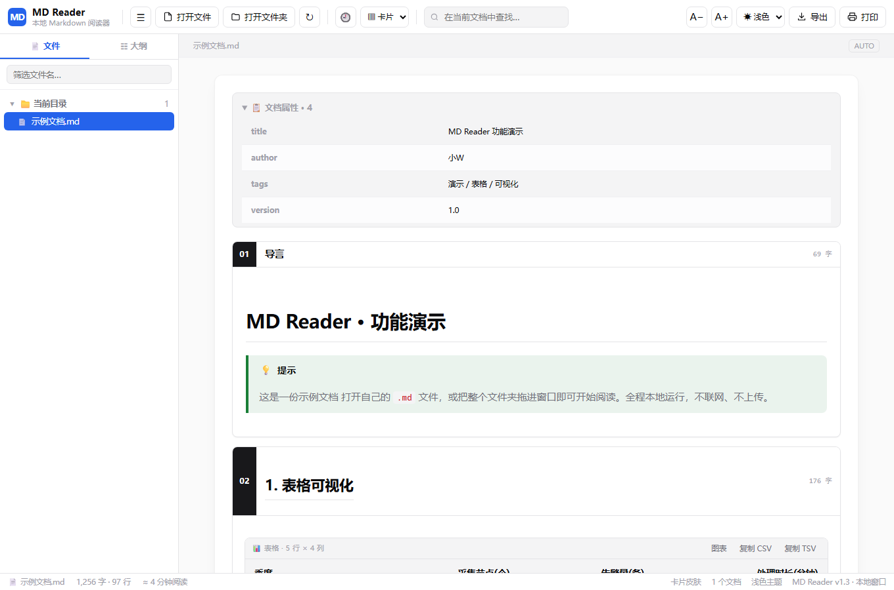
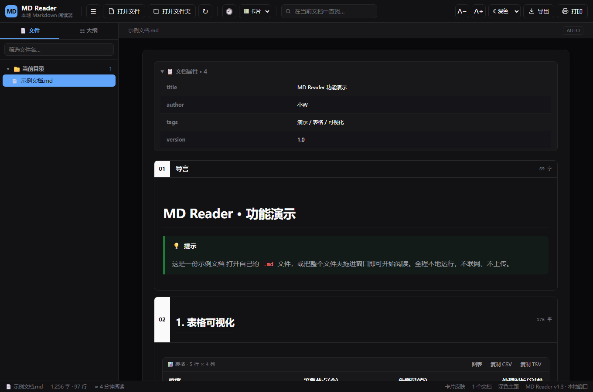
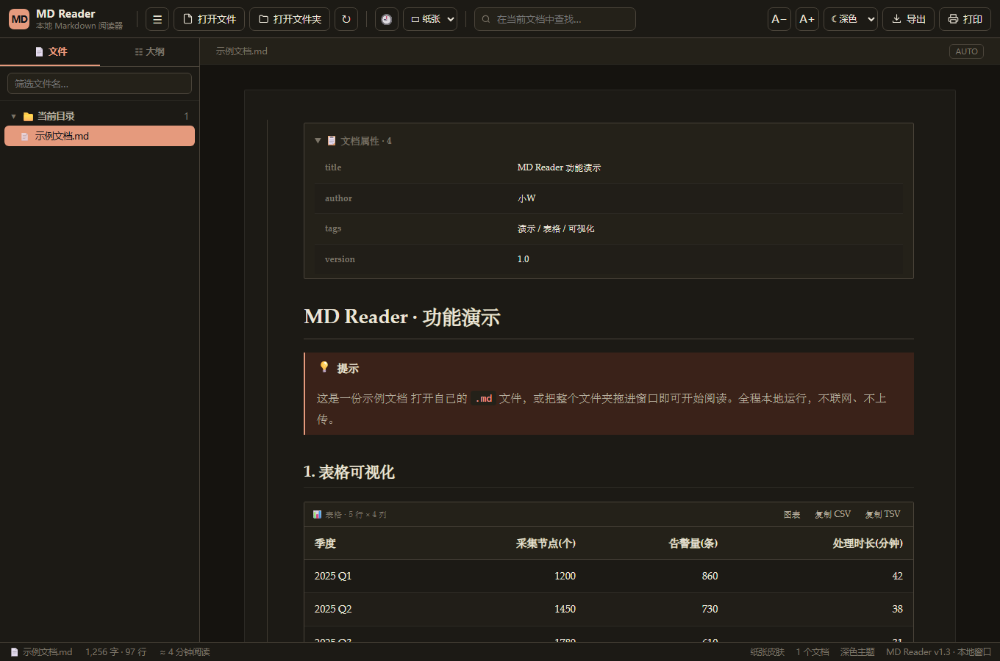
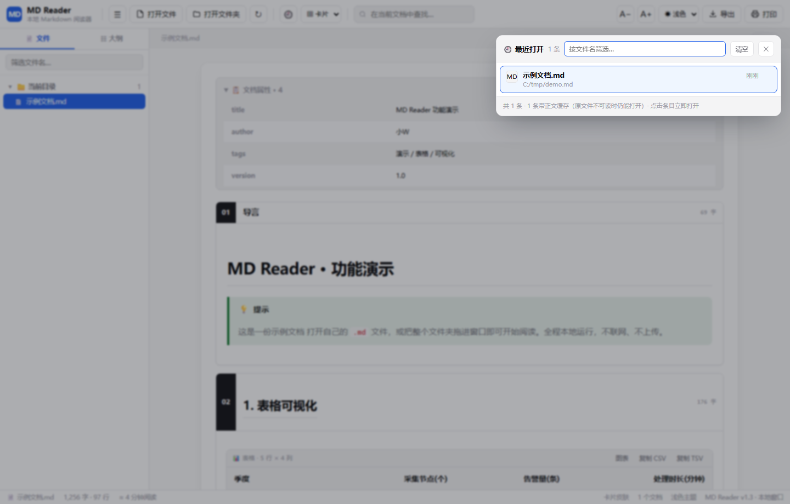

# MD Reader

> **双击 `.md` 就能看的本地阅读器：不装 IDE、不开浏览器标签、不把内网文档传到任何在线编辑器。**

[](https://github.com/OWNER/mdreader/releases)
[](https://github.com/OWNER/mdreader/releases)
[](https://github.com/OWNER/mdreader/stargazers)
[](LICENSE)
[](https://github.com/OWNER/mdreader/releases)
[](#隐私与安全)

**一个 HTML 文件就是完整程序**：marked、highlight.js、mermaid 全部内嵌，运行时不发起任何网络请求。

---

## 解决的痛点

| 场景 | 常见做法 | 问题 | MD Reader |
| --- | --- | --- | --- |
| 只想看一份 `.md` | 开 VS Code / Obsidian | 启动慢、要建库、要装插件 | 双击即开，独立窗口 |
| 运维手册 / 排查指南 | 丢进在线 Markdown 编辑器 | 内网资料出网，合规风险 | 全程本机解析 |
| 文档里表格很宽 | 普通预览器只给静态表 | 没法排序、看趋势 | 表头排序 + 一键柱状图 |
| 1100+ 篇 Obsidian 笔记 | 得先导入整个知识库 | 重、慢 | 拖文件夹即建树，懒加载 |
| 排查手册分很多节 | 长页滚到底 | 找不着 | 卡片皮肤按 `##` 分节编号 |
| 上次看的那份文档 | 重新翻文件夹 | 打断思路 | 最近打开，按路径重读磁盘 |

---

## 三种发行形态

| | 便携版 | 桌面安装版 | iOS / iPadOS 主屏幕版 |
| --- | --- | --- | --- |
| 交付物 | `MDReader-Windows11便携版.zip`（约 2 MB） | `MD Reader Setup 1.3.0.exe`（NSIS 安装包） | `MDReader-iOS-PWA.zip`（约 1 MB） |
| 安装 | 不用装，解压即用 | 双击安装，可选择目录 | 局域网托管后「添加到主屏幕」 |
| 桌面入口 | 手动建快捷方式 | **自动创建桌面 + 开始菜单快捷方式** | ✅ 主屏幕图标、全屏启动 |
| `.md` 关联 | 手动「打开方式」 | **安装时注册 4 种扩展名，可直接设为默认** | ❌ iOS 系统不允许注册默认关联 |
| 双击打开 | 靠 bat 启动器 | 原生单实例，直接传给已开窗口 | ❌ 需在应用内手动选文件 |
| 体积 | 极小 | 较大（Electron 运行时） | 小（同份 HTML + 图标 + manifest） |
| 适合 | U 盘、临时机器、内网离线 | 日常主力机器 | 在 iPhone / iPad 上看 md |

> 三种形态共用同一份 `MDReader.html`，渲染功能完全一致，不存在"精简版"。
> iOS 没有「PC 版」，也不允许第三方注册全局扩展名默认程序——桌面系统对应的是 **macOS**，构建脚本已备好。能力边界见 [`docs/PLATFORM.md`](docs/PLATFORM.md)。

---

## ✨ 特性

### 渲染与可视化

| 类别 | 支持 |
| --- | --- |
| 基础语法 | GFM 表格、标题、列表、任务列表、引用、分割线、粗斜体、删除线、行内代码、链接、图片 |
| 表格可视化 | 斑马纹 / 悬停高亮 / 表头固定、**点击表头排序**、数值列自动右对齐、**一键生成柱状图**、复制为 CSV / TSV |
| 代码 | 40+ 语言语法高亮、语言标签、一键复制 |
| 图表 | ` ```mermaid ` 流程图 / 时序图 / 甘特图，跟随明暗主题 |
| Obsidian | `[[双链]]`、`![[图片]]` 嵌入、`[!note]` Callout、YAML frontmatter 属性表、`#标签` 高亮 |

### 两套排版皮肤

不只是换个边框，**配色、字体、圆角、投影、表格与代码块样式整体切换**。

| | ▥ 卡片 | ▭ 纸张 |
| --- | --- | --- |
| 画布 | 浅灰 `#fafafa` | 暖米 `#f5f2ea` |
| 纸面 | 纯白、12px 圆角、双层柔投影 | 象牙白 `#fdfbf6`、2px 圆角、无投影 |
| 标题 | 系统无衬线 | 衬线（Iowan / Georgia / 宋体） |
| 强调色 | 蓝 `#2563eb` | 暗红 `#8c2f1e` |
| 结构 | 按 `##` 分节，每节一卡，深色编号 `01`/`02` + 字数 | 连续长文 + 页边装订竖线 |
| 适合 | 手册 / 排查指南 / 分条目文档 | 长文阅读、正式报告、打印预览 |

两套皮肤都支持浅色 / 深色 / 护眼三种主题；卡片模式下大纲与锚点跳转照常可用（标题 `id` 原样保留）。

### 阅读与文件

- **最近打开**：最多 30 条，点历史记录时按绝对路径**重读磁盘原文**（不是旧快照）；文件被移走自动退回正文缓存
- 文件树（文件夹递归）、文档大纲、文档内查找（计数 + 前后跳转）、字号调节
- 拖拽单文件 / 整文件夹，UTF-8 / GB18030 编码自动识别，1000+ 文件整库浏览（懒加载）
- 导出**独立 HTML**（样式与图片内嵌）、打印 / 另存为 PDF

---

## 界面预览

| 卡片皮肤（浅色） | 纸张皮肤（浅色） |
| --- | --- |
|  |  |

| 卡片皮肤（深色） | 纸张皮肤（深色） |
| --- | --- |
|  |  |

| 最近打开 | 欢迎页 |
| --- | --- |
|  |  |

---

## 📦 安装

### Windows 桌面版（推荐）

1. 到 [Releases](https://github.com/OWNER/mdreader/releases) 下载 `MD Reader Setup 1.3.0.exe`
2. 双击安装（默认当前用户，无需管理员权限）
3. 安装完成自动在**桌面**与**开始菜单**生成「MD Reader」入口
4. 双击任意 `.md` 即可打开；已开着程序时会复用现有窗口

> 安装时注册 `.md` / `.markdown` / `.mdown` / `.mkd` 四种扩展名，写入 `OpenWithProgids` 与 `Applications\MD Reader.exe\SupportedTypes`（保证「选择其他应用」列表里真的能看到它），并在资源管理器里显示专用文档图标。

### 设置为 `.md` 默认打开程序

**Windows 11**

1. 右键任意 `.md` → **打开方式** → **选择其他应用**
2. 选 **MD Reader** → 勾选 **始终使用此应用打开 .md 文件** → 确定
3. 或走：设置 → 应用 → 默认应用 → 按文件类型选 `.md` → MD Reader

**macOS**

访达里选中 `.md` → `⌘I` 显示简介 → **打开方式** 选 MD Reader → **全部更改…**

### 便携版（免安装）

下载 `MDReader-Windows11便携版.zip` → 解压到任意目录（含 U 盘）→ 双击 `启动 MDReader.bat`。

也可以把 `.md` 拖到 `用此程序打开MD.bat` 上，或在右键「打开方式」里关联这两个 bat。

> 需要 Windows 11 自带的 Microsoft Edge（用于无地址栏的应用窗口模式）。纯 HTML 文件双击也能用，只是会带地址栏。

### iOS / iPadOS 主屏幕版（PWA，可行范围）

下载 `MDReader-iOS-PWA.zip` → 解压 → 在该目录执行 `python -m http.server 8000 --bind 0.0.0.0` → iPhone/iPad 用 Safari 打开 `http://<电脑局域网IP>:8000/` → **分享 → 添加到主屏幕**。主屏幕会出现「MD Reader」图标，全屏启动、无地址栏。看文档时在应用内点「打开文件」，从「文件」App 里选 `.md`。

> 这是 iOS 上最接近"桌面图标"的形态，**不能**注册 `.md` 默认关联，也不能双击自动打开。详见包内 `README.md` 与 [平台能力说明](docs/PLATFORM.md)。

### macOS

源码与构建配置在 `MDReader/desktop/`。`.dmg` **必须在 macOS 上编译**（Apple 代码签名与 `iconutil` 限制），详见 [桌面版构建说明](MDReader/desktop/README.md)。

---

## 平台支持矩阵

| 能力 | Windows 11 | macOS 11+ | iOS / iPadOS |
| --- | --- | --- | --- |
| 安装后桌面图标 | ✅ | ✅（Dock / 应用程序） | ✅ 主屏幕图标（PWA，无"桌面"概念） |
| 注册为 `.md` 默认打开程序 | ✅ | ✅ | ❌ 系统不允许第三方注册全局扩展名默认程序 |
| 接收外部 `.md` 文件 | ✅ 双击 / 命令行 | ✅ 双击 / 拖到 Dock | ⚠️ 应用内手动选取；「共享表单」需原生 App |
| 离线、无网络请求 | ✅ | ✅ | ✅（HTTPS 托管时由 Service Worker 缓存） |
| 本项目是否原生支持 | ✅ 已交付安装包 | ✅ 同源代码 + 构建脚本 | ⚠️ 已交付 PWA 包，非原生 App（Electron 不支持 iOS） |

**关于 iOS**：iOS/iPadOS 是移动系统，没有"桌面快捷方式"和"系统级默认打开程序"机制。系统只提供 `CFBundleDocumentTypes` 文档类型注册，让 App 出现在「共享 / 打开方式」列表里，且**必须由用户每次手动选择**。此外 Electron 不支持 iOS，要做原生版必须另起 SwiftUI + WKWebView 工程，并受 App Store 沙箱限制。本仓库交付的是能力范围内的 PWA 包，不假装支持默认关联。详见 [平台能力说明](docs/PLATFORM.md)。

---

## 从源码构建

```bash
git clone https://github.com/OWNER/mdreader.git
cd mdreader/MDReader/desktop

npm install                 # 安装 Electron 与 electron-builder
npm run icons                # 生成应用 / 文件类型图标（可选，仓库已带）
npm run build:win            # → desktop/release/MD Reader Setup 1.3.0.exe
# macOS 上：npm run build:mac → .dmg
```

便携版与 iOS 包不需要 Node：

```bash
python src/build.py                    # 重新生成单文件 MDReader.html
python src/pack.py                     # → MDReader-Windows11便携版.zip
python MDReader/ios/build-pwa.py       # → MDReader-iOS-PWA.zip
```

国内网络建议设置镜像（GitHub 二进制下载常被拦）：

```bash
export ELECTRON_MIRROR="https://npmmirror.com/mirrors/electron/"
export ELECTRON_BUILDER_BINARIES_MIRROR="https://npmmirror.com/mirrors/electron-builder-binaries/"
npm install
```

**只改渲染层**（`src/template.html` / `src/app.js`）时，重新生成单文件即可，桌面版与便携版会同时更新：

```bash
python src/build.py                  # → dist/MDReader.html
python desktop/scripts/sync-app.py    # 同步进桌面壳
python desktop/scripts/verify-portable.py   # 便携版 17 项回归
python src/pack.py                   # 重新打便携版 zip
```

---

## 目录结构

```
mdreader/
├── README.md                    ← 本文件
├── LICENSE                      MIT
├── CHANGELOG.md                 版本变更记录
├── CONTRIBUTING.md              贡献指南
├── .github/
│   ├── ISSUE_TEMPLATE/           Bug / 需求模板
│   ├── dependabot.yml            依赖漏洞自动扫描
│   └── workflows/ci.yml          语法检查 + 单文件构建校验
├── docs/
│   ├── screenshots/             6 张界面截图
│   ├── PLATFORM.md               三平台能力边界
│   └── RELEASE.md                发版流程 / Release 文案模板 / Topics
└── MDReader/
    ├── dist/                    便携版成品（解压即用）
    │   ├── MDReader.html          主程序，3.44 MB 单文件
    │   ├── 启动 MDReader.bat
    │   ├── 用此程序打开MD.bat
    │   ├── open-with.ps1
    │   ├── 示例文档.md / assets/
    │   └── 使用说明.md
    ├── src/                      源码
    │   ├── template.html         界面与两套皮肤 CSS
    │   ├── app.js                 全部逻辑
    │   ├── vendor/               marked / hljs / mermaid（离线）
    │   ├── build.py               内嵌依赖 → 单文件 HTML
    │   └── pack.py                便携版打包
    └── desktop/                  桌面安装版
        ├── main.js                单实例 / 文件关联 / 菜单 / 编码识别
        ├── preload.js             安全桥接白名单
        ├── app/                   与便携版共用的渲染产物
        ├── build/                 图标 + NSIS 片段
        ├── scripts/               同步 / 图标 / 回归验证
        └── release/               构建输出（.exe / .dmg）
    └── ios/                       iOS / iPadOS 主屏幕版（PWA）
        ├── build-pwa.py           注入 manifest / 图标 → 站点 + zip
        └── site/                  生成物（已 gitignore）
```

---

## 隐私与安全

- **零网络请求**：marked 15 / highlight.js 11 / mermaid 10 全部内嵌，代码里没有任何 `fetch` 到外部域
- **零上传**：文档只在本机浏览器 / Electron 渲染进程内解析
- **零注册表污染**（便携版）：bat 启动器只写同目录的 `_autoload.js`，不改注册表，随时删目录即卸载
- **桌面版**：仅通过 `contextBridge` 暴露白名单方法，`nodeIntegration: false` + `contextIsolation: true`；外部链接一律交给系统浏览器
- 最近打开 / 主题偏好存在本机 `localStorage`（便携版）或 `%APPDATA%\mdreader`（桌面版），不跨设备同步

---

## 版本与路线图

见 [CHANGELOG.md](CHANGELOG.md)。当前 **v1.3.0**。

| 计划 | 状态 |
| --- | --- |
| 卡片 / 纸张双皮肤 + 最近打开 | ✅ v1.3.0 |
| Windows 安装包 + `.md` 关联 + 桌面图标 | ✅ v1.3.0 |
| macOS `.dmg` 构建配置 | ✅ 配置就绪，需在 Mac 上编译 |
| iOS 文档类型注册（共享表单接收 `.md`） | 🔜 规划中，需另起 SwiftUI 工程 |
| 全文搜索跨文档 | 💡 待评估 |

---

## 发布前必改

仓库里的 `OWNER` 是占位符（badge 与 clone 链接共 6 处），发布前全局替换成你的 GitHub 用户名：

```bash
# 在仓库根目录执行
grep -rl "OWNER" --include="*.md" --include="*.yml" . # 先看一眼
# 然后按 docs/RELEASE.md 里的清单逐项替换
```

Topics 建议：`markdown` `markdown-viewer` `offline` `electron` `obsidian` `mermaid` `table-visualization` `windows` `file-association` `中文`。

---

## 贡献与协议

欢迎提 Issue / PR，见 [CONTRIBUTING.md](CONTRIBUTING.md)。

基于 **MIT** 协议开源，见 [LICENSE](LICENSE)。第三方依赖协议见 `MDReader/src/vendor/`。
