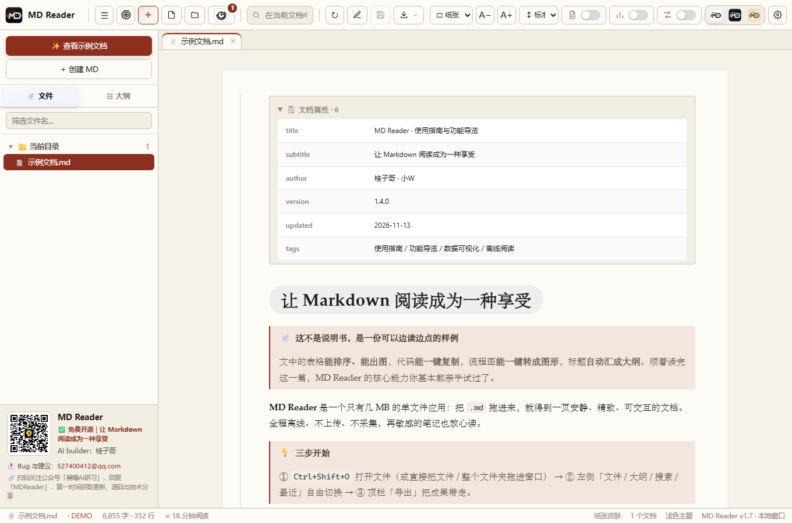
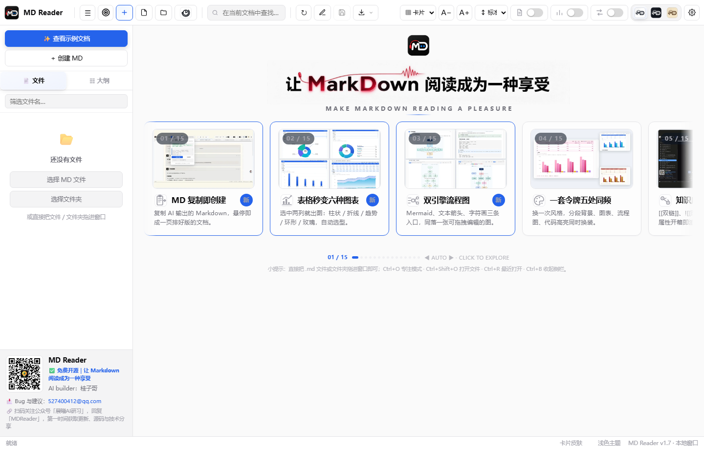

# MD Reader

[English](README.en.md) · **简体中文**

> **双击 `.md` 就能看的本地阅读器。一个 4.6 MB 的 HTML 文件，零安装、零联网、零账号。**

[](LICENSE)
[](docs/PLATFORM.md)
[](#隐私与安全)
[](#为什么这么小)

<p align="center">
  
</p>

**目录**：[为什么是它](#为什么是它) · [五种交付形态](#五种交付形态) · [特性](#-特性) · [界面](#界面) · [现在怎么用](#现在怎么用) · [平台支持](#平台支持) · [和同类工具比](#和同类工具比) · [常见问题](#常见问题) · [从源码构建](#从源码构建) · [目录结构](#目录结构) · [隐私与安全](#隐私与安全) · [版本与路线图](#版本与路线图) · [贡献与协议](#贡献与协议)

---

## 为什么是它

市面上的 Markdown 工具都在往「更全能」走：加账号、加云同步、加 AI 摘要、加插件市场。**MD Reader 反着做——只做「看」这一件事，并且把它做到顺手。**

| | 它是什么 | 它不是什么 |
| --- | --- | --- |
| **小而美** | 一个 4.6 MB 的 HTML 就是完整程序，依赖全部内嵌 | 不是 100 MB 起的 Electron 全家桶（安装版除外，那是另一条路） |
| **有态度** | 明确不做账号、不做云同步、不做遥测、不内置 AI | 不假装全能，做不到的写在 [平台支持](#平台支持) 里 |
| **有审美** | 两套排版皮肤 × 三套主题 × 四套文档风格，均为整体重绘 | 不是换个边框就号称「主题」 |
| **有温度** | 护眼配色过 WCAG 对比度、无广告、无弹窗、无追踪 | 不拿你的文档换任何东西 |

它解决的是一类被忽略的小事：

| 场景 | 常见做法 | 问题 | MD Reader |
| --- | --- | --- | --- |
| 只想看一份 `.md` | 开 VS Code / Obsidian | 启动慢、要建库、要装插件 | 双击即开，独立窗口 |
| 运维手册 / 排查指南 | 丢进在线 Markdown 编辑器 | 内网资料出网，合规风险 | 全程本机解析，0 请求 |
| 文档里表格很宽 | 普通预览器只给静态表 | 没法排序、看趋势 | 表头排序 + 六种图表 |
| 1100+ 篇 Obsidian 笔记 | 得先导入整个知识库 | 重、慢 | 拖文件夹即建树，懒加载 |
| 排查手册分很多节 | 长页滚到底 | 找不着 | 卡片皮肤按 `##` 分节编号 |
| 架构图画在代码块里 | 只能看字符画 | 不能编辑、不能导出 | 纯算法识别成可拖拽矢量图 |

---

## 五种交付形态

| | 便携版 | Windows 安装版 | Win 免安装 | iOS / iPadOS | 国际版 |
| --- | --- | --- | --- | --- | --- |
| 交付物 | `MDReader-便携版-v1.7.0.zip` | `MD Reader Setup 1.7.0.exe` | `MDReader-Win免安装-v1.7.0.zip` | `MDReader-iOS-PWA-v1.7.0.zip` | `MDReader-International-v1.7.0.zip` |
| 体积 | ≈1.7 MB | ≈115 MB | ≈155 MB | ≈2.4 MB | ≈3.7 MB |
| 安装 | 解压即用 | 双击安装 | 解压即用 | 局域网托管后「添加到主屏幕」 | 解压即用 |
| 桌面入口 | 手动建快捷方式 | 自动桌面 + 开始菜单 | 手动 | 主屏幕图标、全屏 | 手动 |
| `.md` 关联 | 手动「打开方式」 | 注册 4 种扩展名，可设默认 | 手动 | ❌ 系统不允许 | 手动 |
| 默认语言 | 简体中文 | 简体中文 | 简体中文 | 简体中文 | English |
| 适合 | U 盘、临时机器、内网 | 日常主力机 | 不想装、又要原生窗口 | 手机 / 平板看 md | 英文环境、海外分发 |

> **五个形态共用同一份 `MDReader.html`**，渲染功能完全一致，不存在「精简版」。
> 国内版与国际版**只差一行**（`BUILD_DEFAULT_LANG`），其余逐字节相同——这是构建脚本保证的，不是承诺。
> 能力边界见 [`docs/PLATFORM.md`](docs/PLATFORM.md)。

---

## ✨ 特性

### 渲染与可视化

| 类别 | 支持 |
| --- | --- |
| 基础语法 | GFM 表格、标题、列表、任务列表、引用、分割线、粗斜体、删除线、行内代码、链接、图片 |
| 表格 | 斑马纹 / 悬停高亮 / 表头固定、点击表头排序、数值列自动右对齐、复制为 CSV / TSV |
| **图表（6 种）** | 自动 / 柱状 / 折线 / 趋势面积 / 环形饼图 / 玫瑰图；饼图严格按 `value/total×360°` 分角，不是等分 |
| 代码 | 40+ 语言语法高亮、语言标签、一键复制 |
| Mermaid | 流程图 / 时序图 / 甘特图，跟随明暗主题 |
| **Unicode 架构图** | 代码块里的 `┌─┐│└┘` 架构图由纯算法识别成**可拖拽、可编辑、可导出**的矢量流程图（零 AI、零网络） |
| **文本流程图** | `A → B → C` 这类箭头文本自动转成图形，同样可编辑 |
| Obsidian | `[[双链]]`、`![[图片]]` 嵌入、`[!note]` Callout、YAML frontmatter 属性表、`#标签` 高亮 |

### 流程图：结构 × 风格 × 编辑，三个正交维度

| 维度 | 选项 | 说明 |
| --- | --- | --- |
| **结构** | 自动 / 流水线 / 思维导图 / 组织图 / 时间轴 | 决定「怎么排」，**每张图可在右上角单独覆盖**，与全局默认解耦 |
| **风格** | 经典 / 极简 / 商务 / 活力 / 暗夜 | 只换配色与描边，绝不重排 |
| **编辑** | 拖拽 / 改文字 / 换颜色 / 增删节点 / 连线 / 撤销 | 落点直接改当前 SVG DOM |

5 结构 × 5 风格 = **25 种观感**。所有导出（下载 SVG / 复制 Mermaid 源码 / 导出 HTML / 导出 Word / 打印 PDF）都以**最后编辑状态**为准——导出不重绘，所以不会「导完变回自动布局」。

### 排版：两套皮肤 × 三套主题 × 四套文档风格

两套皮肤不是换个边框，**配色、字体、圆角、投影、表格与代码块样式整体切换**。

| | ▥ 卡片 | ▭ 纸张 |
| --- | --- | --- |
| 画布 | 浅灰 `#fafafa` | 暖米 `#f5f2ea` |
| 纸面 | 纯白、12px 圆角、双层柔投影 | 象牙白 `#fdfbf6`、2px 圆角、无投影 |
| 标题 | 系统无衬线 | 衬线（Iowan / Georgia / 宋体） |
| 强调色 | 蓝 `#2563eb` | 暗红 `#8c2f1e` |
| 结构 | 按 `##` 分节，每节一卡，编号 `01`/`02` + 字数 | 连续长文 + 页边装订竖线 |

三套主题（**浅色 / 深色 / 护眼**）与皮肤正交：切换主题整体替换画布、纸面、文字、边框、强调色、代码块与表格。护眼是低蓝光暖米黄，与纯白一眼可辨。

四套**文档风格**（素雅 / 科技 / 政务 / 可爱）统一驱动分段背景、卡片徽章、图表色板、流程图强调色与代码关键字高亮，并按明暗派生可读变体——整篇文档是一种气质，不是一个色块。

### 双语与国际化

界面支持 **简体中文 / English / 跟随系统**，偏好持久化。**你自己打开的 `.md` 永远不会被翻译。** 国际版只是把默认语言设为 English。

### 阅读与文件

- **最近打开**：最多 30 条，按绝对路径**重读磁盘原文**（不是旧快照）；文件被移走自动退回缓存
- 文件树（文件夹递归）、大纲、文档内查找（计数 + 前后跳转）、字号调节、阅读宽度
- 拖拽单文件 / 整文件夹，UTF-8 / GB18030 自动识别，1000+ 文件整库浏览（懒加载）
- **新建 MD**：空白文档，或一键粘贴 AI 对话里的 Markdown；`Ctrl+S` 存成真实 `.md`
- 导出**独立 HTML**（样式与图片内嵌，离线可看）、Word、打印 / 另存为 PDF

---

## 界面

| 卡片 · 浅色 | 纸张 · 浅色 |
| --- | --- |
|  |  |

| 卡片 · 深色 | 纸张 · 深色 |
| --- | --- |
|  |  |

| 最近打开 | 欢迎页 |
| --- | --- |
|  |  |

---

## 现在怎么用

**这个仓库当前只开源代码与构建脚本，预编译包暂未开放下载。**（在你确认后才会开启 Release 附件。）

三条即时可用的路径，都不需要等：

```bash
# ① 现在就能用：浏览器直接打开已构建好的单文件
#    仓库里就带着成品，双击即可
MDReader/dist/MDReader.html

# ② 要便携版 zip（解压即用 + 启动器 + 示例文档）
cd MDReader && python tools/pack-portable.py

# ③ 要 Windows 安装包（需 Node 18+）
cd MDReader/desktop && npm install && npm run build:win
```

> 想第一时间拿到预编译包：点右上角 **⭐ Star**，Release 开放时会在动态里看到。也可以在公众号回复 `MDReader` 取下载指引。

---

## 平台支持

| 能力 | Windows 11 | macOS 11+ | iOS / iPadOS |
| --- | --- | --- | --- |
| 安装后桌面图标 | ✅ | ✅（Dock / 应用程序） | ✅ 主屏幕图标（PWA，无「桌面」概念） |
| 注册为 `.md` 默认打开程序 | ✅ | ✅ | ❌ 系统不允许第三方注册全局扩展名默认程序 |
| 接收外部 `.md` 文件 | ✅ 双击 / 命令行 | ✅ 双击 / 拖到 Dock | ⚠️ 应用内手动选取；「共享表单」需原生 App |
| 离线、无网络请求 | ✅ | ✅ | ✅（HTTPS 托管时由 Service Worker 缓存） |
| 本项目是否原生支持 | ✅ 已交付安装包 | ✅ 同源代码 + 构建脚本 | ⚠️ 已交付 PWA 包，非原生 App（Electron 不支持 iOS） |

**关于 iOS**：iOS/iPadOS 没有「桌面快捷方式」和「系统级默认打开程序」机制。系统只提供 `CFBundleDocumentTypes` 文档类型注册，让 App 出现在「共享 / 打开方式」列表里，且**必须由用户每次手动选择**。本仓库交付的是能力范围内的 PWA 包，不假装支持默认关联。详见 [平台能力说明](docs/PLATFORM.md)。

---

## 和同类工具比

如果你的需求是每天写长文，它不是主力工具——**编辑只做到「够改一行」**（按块编辑 + `Ctrl+S` 写回原文件，没有语法高亮编辑、没有插件）。它主要解决「**看**一份已经存在的本地文档」。

| 场景 | 更该用谁 | 为什么 |
| --- | --- | --- |
| 要写文档 | Typora | 所见即所得，写作体验是这个品类的标杆 |
| 要管理 1000+ 篇笔记、要双链与图谱 | Obsidian | 知识库是它的核心；本项目只做了「显示」那一层 |
| 边写代码边看 README | VS Code | 你本来就在里面，多装一个工具是负担 |
| 要多人协作 / 云同步 | 飞书文档 / 语雀 / Notion | 本项目明确不做账号与同步 |
| 文档里有数学公式 | 换别的 | **不支持 KaTeX / MathJax，这是硬缺口** |
| 只看本地 `.md`，不想开任何编辑器 | **MD Reader** | 双击即开、零联网、按章节切卡片、表格可排序出图 |

同类项目里，MarkText（64k★）、Logseq（45k★）、SingleFile（23k★）、HedgeDoc（7.5k★）都是 **AGPL**；Zettlr / VNote 是 **GPL / LGPL**。**MD Reader 是 MIT**——可以直接被商业产品或内网工具链集成，这一条对工程团队是实打实的差别。

完整的 16 维对比（含 Typora / Obsidian / MarkText / VS Code / 在线编辑器）见 **[docs/COMPARISON.md](docs/COMPARISON.md)**。

---

## 常见问题

| 问题 | 答案 |
| --- | --- |
| 能不能编辑？ | 能：按块编辑 + `Ctrl+S` 写回原文件；但不是主力写作工具 |
| 真的完全不联网？ | 是，而且可以自己 grep + 拔网线验证 |
| 4.6 MB 打开慢吗？ | 冷启动约 0.4–1.0 秒，本地文件无网络请求 |
| 为什么比 v1.3 大了 0.8 MB？ | 新增界面语言包、Unicode 架构图算法、导出运行时、15 张欢迎屏演示图 |
| 安装包为什么 100 多 MB？ | 便携版 1.7 MB 就够用；安装版大是因为自带 Electron 运行时 |
| macOS 能用吗？ | 能用，但要自己编译，作者未实测 |
| 架构图识别要联网 / 要 AI 吗？ | 都不要，纯 JS 算法，本地按显示列宽切格子 |
| 流程图为什么有的不跟随深色主题？ | 进阶语法交回官方 Mermaid 渲染，是有意的降级设计 |

完整版（含编码、图片路径、iOS 限制、导出 PDF）见 **[docs/FAQ.md](docs/FAQ.md)**。

---

## 从源码构建

```bash
git clone https://github.com/guizige-890323/mdreader.git
cd mdreader

# 单文件（不需要 Node）
python MDReader/src/gen-demo.py                          # 示例文档 → app.js + 两份示例 md
python MDReader/src/build.py                             # → MDReader/dist/MDReader.html（中文默认）
python MDReader/src/build.py --edition global \
    --out MDReader/dist-intl/MDReader.html               # → 国际版（英文默认）

# 便携版 / 国际版 / iOS 包
python MDReader/tools/pack-portable.py                   # → 发布包/MDReader-便携版-v1.7.0.zip
python MDReader/src/pack-intl.py                         # → 发布包/MDReader-International-v1.7.0.zip
python MDReader/ios/build-pwa.py                         # → 发布包/MDReader-iOS-PWA-v1.7.0.zip

# Windows 安装版（需 Node 18+）
cd MDReader/desktop
npm install
npm run build:win                                        # → desktop/release-win33/MD Reader Setup 1.7.0.exe
```

**改渲染层的正确顺序**（漏一步就会出现「网页版是新的、桌面版是旧的」）：

```bash
python src/gen-demo.py            # 只在改示例文档时需要
python src/build.py               # 中文版
python src/build.py --edition global --out dist-intl/MDReader.html
python desktop/scripts/sync-app.py  # 桌面壳必须从 dist/ 同步，不能手放
```

> **换图标必须重打包**：`npm run icons` 从 `brand-source/` 生成 ICO、NSIS 向导位图和应用内 logo 后，还要重跑上面整条链。只改 `build/` 里的图片，已生成的安装包和便携版里仍旧是旧图。

国内网络建议设置镜像：

```bash
export ELECTRON_MIRROR="https://npmmirror.com/mirrors/electron/"
export ELECTRON_BUILDER_BINARIES_MIRROR="https://npmmirror.com/mirrors/electron-builder-binaries/"
```

---

## 目录结构

```
mdreader/
├── README.md / README.en.md      中英文说明
├── LICENSE                       MIT + 第三方组件附录
├── CHANGELOG.md                  版本变更记录（唯一事实源）
├── CONTRIBUTING.md               贡献指南
├── CODE_OF_CONDUCT.md            贡献者公约 2.1
├── SECURITY.md                   安全漏洞上报流程
├── .github/
│   ├── ISSUE_TEMPLATE/           Bug / 需求表单
│   ├── PULL_REQUEST_TEMPLATE.md  PR 自查清单
│   └── workflows/ci.yml          语法 + 构建 + 漂移检查 + 回归
├── docs/
│   ├── screenshots/              界面截图
│   ├── PLATFORM.md               三平台能力边界
│   ├── FAQ.md                    常见问题
│   ├── COMPARISON.md             16 维对比
│   ├── RELEASE.md                发版流程 / Release 文案模板
│   └── THIRD-PARTY-LICENSES.md   第三方依赖许可
└── MDReader/
    ├── dist/                     中文版成品（提交进仓库）
    │   ├── MDReader.html         主程序，单文件 4.6 MB
    │   ├── 启动 MDReader.bat / 用此程序打开MD.bat / open-with.ps1
    │   ├── 示例文档.md / assets/
    │   └── 使用说明.md
    ├── dist-intl/                国际版成品（与中文版仅差默认语言一行）
    ├── src/                      源码
    │   ├── template.html         界面骨架与皮肤 CSS
    │   ├── app.js                全部逻辑
    │   ├── i18n.js               中 / 英语言包
    │   ├── mermaid-flow.js       自研 Mermaid 渲染器（MD FLOW）
    │   ├── text-flow.js          箭头文本 → 图形
    │   ├── ascii-diagram.js      Unicode 框线架构图 → 语义图
    │   ├── export-runtime.js     导出页运行时（text/plain 内嵌，不执行）
    │   ├── demo/                 示例文档单一数据源（zh / en）
    │   ├── vendor/               marked 15 / hljs 11 / mermaid 10（离线）
    │   ├── build.py              内嵌依赖 → 单文件 HTML
    │   └── pack-intl.py          国际版打包
    ├── tools/                    打包 / 回归 / 素材生产脚本
    ├── desktop/                  Windows / macOS 桌面版
    │   ├── main.js               单实例 / 文件关联 / 编码识别
    │   ├── preload.js            安全桥接白名单
    │   ├── app/                  ← 由 sync-app.py 从 dist/ 同步
    │   ├── build/                图标 + NSIS 片段 + 离线 rcedit
    │   └── scripts/              同步 / 图标 / 回归验证
    └── ios/                      iOS / iPadOS 主屏幕版（PWA）
        ├── build-pwa.py          注入 manifest / 图标 → 站点 + zip
        └── site/                 ← 生成物
```

`dist/` 与 `dist-intl/` 是**提交进仓库的构建产物**：改了 `src/` 必须重建并一起提交，否则 CI 的漂移检查会失败。`desktop/app/`、`desktop/release-*/`、`ios/site/` 由脚本生成，不入库。

---

## 为什么这么小

| 组件 | 处理方式 | 体积 |
| --- | --- | --- |
| marked 15 / highlight.js 11 / mermaid 10 | 构建期内嵌 | ≈1.1 MB |
| 主逻辑 + 自研渲染器 + 语言包 | 纯 JS，无框架 | ≈1.5 MB |
| 品牌图标 / 换肤图标 / 口号海报 | base64 内嵌 | ≈0.3 MB |
| 欢迎屏 15 张演示图 | webp，构建期内嵌 | ≈0.3 MB |
| 导出运行时 | text/plain 槽位，不执行 | ≈22 KB |

没有打包器、没有框架、没有 polyfill。**你能在 `src/` 里读到运行时的每一行。**

---

## 隐私与安全

- **零网络请求**：三个依赖全部内嵌，代码里没有任何 `fetch` 到外部域
- **零上传**：文档只在本机浏览器 / Electron 渲染进程内解析
- **零遥测**：没有埋点、没有崩溃上报、没有用户 ID
- **零注册表污染**（便携版）：bat 启动器只写同目录的 `_autoload.js`，删目录即卸载
- **桌面版**：`contextBridge` 白名单，`nodeIntegration: false` + `contextIsolation: true`；外部链接交给系统浏览器
- 最近打开 / 主题偏好只存本机 `localStorage` 或 `%APPDATA%\mdreader`，不跨设备同步

---

## 版本与路线图

当前 **v1.7.0**，完整变更见 [CHANGELOG.md](CHANGELOG.md)。

| 计划 | 状态 |
| --- | --- |
| 卡片 / 纸张双皮肤 + 最近打开 | ✅ v1.3.0 |
| Windows 安装包 + `.md` 关联 + 桌面图标 | ✅ v1.3.0 |
| 流程图 5 结构 × 5 风格 + 可视化编辑 | ✅ v1.5.0 |
| Unicode 框线架构图 → 可编辑矢量图 | ✅ v1.6.0 |
| 单图结构覆盖 + 统一文档风格 | ✅ v1.7.0 |
| 界面多语言（中 / 英 / 跟随系统） | ✅ v1.7.0 |
| macOS `.dmg` | ✅ 配置就绪，需在 Mac 上编译 |
| iOS 文档类型注册（共享表单接收 `.md`） | 🔜 需另起 SwiftUI 工程 |
| 全文搜索跨文档 | 💡 待评估 |

---

## 仓库信息

- 仓库地址：<https://github.com/guizige-890323/mdreader>
- 当前版本：**v1.7.0**
- 许可证：MIT
- 支持平台：Windows 10 / 11 · macOS 11+（需自行编译）· iOS / iPadOS（PWA）

---

## 贡献与协议

欢迎提 Issue / PR，见 [CONTRIBUTING.md](CONTRIBUTING.md)。参与前请阅读[行为准则](CODE_OF_CONDUCT.md)，安全问题请按 [SECURITY.md](SECURITY.md) 私下上报。

基于 **MIT** 协议开源，见 [LICENSE](LICENSE)。内嵌第三方组件的许可清单见 [docs/THIRD-PARTY-LICENSES.md](docs/THIRD-PARTY-LICENSES.md)。

---

## 关注公众号

产品更新、源码解析与技术分享首发在公众号 **「晨曦AI研习」**。回复 `MDReader` 可拿下载地址与 30 秒上手指引。

<p align="center">
  
</p>

---

**如果这个项目对你有用，点个 ⭐ Star 是成本最低的支持方式。** 有 bug 或想要的功能，按 [Issue 模板](.github/ISSUE_TEMPLATE/bug_report.yml) 提一个。个人项目响应可能慢一两天，但都会看。

<sub>MD Reader 是一个人的项目：没有公司、没有融资、没有增长指标。它只是把「看文档」这件事做顺手了一点。⚡</sub>
