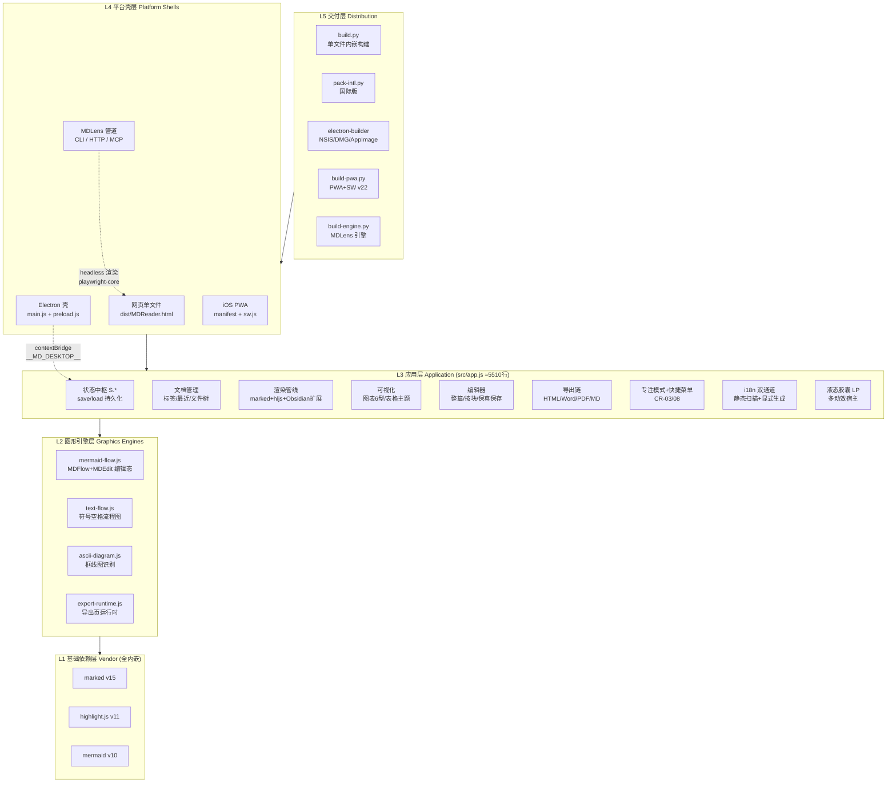

# MD Reader 技术架构设计文档

| 文档属性 | 内容 |
|---|---|
| 文档编号 | MDR-DESIGN-02 |
| 版本 | v1.0 |
| 编制日期 | 2026-11-16 |
| 适用产品版本 | MD Reader v1.7.0 + CR-2026-11-16-08 · MDLens v0.2.0 |
| 文档状态 | 评审稿 |
| 关联文档 | 01-产品设计方案 · 03-功能架构设计说明 · 04-分阶段交付计划 |
| 编制依据 | `MDReader/src/*`、`desktop/main.js|preload.js|package.json`、`ios/*`、`mdlens/lib/*` 真实源码 |

---

## 1. 架构总览

### 1.1 设计原则

| # | 原则 | 落地体现 |
|---|---|---|
| A1 | **单文件离线优先** | 全部 vendor/样式/脚本/品牌图 base64 内嵌进一个 HTML，双击即用、断网可用 |
| A2 | **一引擎多壳** | 同一渲染引擎（template + app.js + 三个图形模块）被网页/桌面/PWA/MDLens 四种壳复用，视觉与行为天然一致 |
| A3 | **单一数据源** | 每个设置只有一个权威状态；所有 UI 是投影；setter 汇聚点强制双向同步（CR-08 确立） |
| A4 | **纯算法优先于 AI** | 文本流程图/ASCII 图识别全部确定性算法，可测试、可复现、零成本 |
| A5 | **零信任外部输入** | Markdown 是不可信输入：自研 UI 一律 `esc()`；渲染管线输出做 XSS 边界控制（见 §6） |
| A6 | **闸门式演进** | 变更单 → 网页版验证 → 人工确认 → 多版本同步；历史断言零删除零放宽 |

### 1.2 分层架构图



### 1.3 层间约束

- **L1 不感知上层**：vendor 以全局脚本注入，构建时 `</script` 转义防提前闭合。
- **L2 只暴露纯函数接口**：`MDFlow.render(src, host)`、`MDEdit.attach/toggle/command`、`TextFlow`/`AsciiDiagram` 解析函数；不直接读写应用状态。
- **L3 是唯一状态持有者**：L4 壳通过桥接口请求能力，不反向注入业务逻辑。
- **L5 只做装配不做逻辑**：构建脚本仅内嵌/替换 token/拷贝，禁止在构建期改写业务代码。

---

## 2. 技术栈选型说明

### 2.1 选型总表

| 层 | 技术 | 版本 | 选型理由 | 备选与否决原因 |
|---|---|---|---|---|
| Markdown 解析 | marked | v15 | 体积小（39KB）、GFM 完整、renderer 可定制（Wiki 链接/Callout 注入点） | markdown-it：插件生态强但体积与复杂度超出需求；remark：AST 强但需构建链，违背单文件原则 |
| 代码高亮 | highlight.js | v11 | 127KB 覆盖主流语言、CSS 变量化主题可随三主题切换 | Prism：体积相近但自动加载语言机制与离线内嵌冲突 |
| 标准流程图 | mermaid | v10 | 事实标准、用户存量 `.md` 里大量 mermaid 代码块 | 自研全量替代：成本过高；v10 锁定避免 v11 breaking change |
| 自研流程图 | MDFlow（mermaid-flow.js） | 自研 | 五套风格、结构×样式正交、编辑态持久化、导出内联变量——mermaid 无法满足 | 直接改 mermaid 源码：维护成本不可控 |
| 文本/ASCII 图 | text-flow.js / ascii-diagram.js | 自研纯算法 | 确定性、零依赖、可断言测试（48+33+101 条） | AI 识别：不可复现、有成本、违背离线红线 |
| 桌面壳 | Electron | 45.3.0 | 与网页版同引擎零移植成本；文件关联/单实例/系统菜单成熟 | Tauri：体积小但需 Rust 工具链且 WebView 差异会破坏"四端一致"；NW.js：生态萎缩 |
| 打包 | electron-builder | 26.0.12 | NSIS 定制（installer.nsh 补 OpenWithProgids）、fileAssociations、afterPack 钩子 | 手写 NSIS：维护成本高 |
| 编码转换 | iconv-lite | ^0.7.3 | 桌面端 GBK/GB18030 中文旧文件读取 | 浏览器 TextDecoder：部分编码不支持 |
| PWA | 原生 Service Worker | 缓存 v22 | 零框架、缓存策略完全可控、版本化失效 | Workbox：引入构建链违背单文件原则 |
| AI 管道 | Node.js ≥18 + playwright-core | peerDep ≥1.40 | MCP stdio 协议原生实现；headless 复用同一引擎保证视觉一致 | 服务端独立渲染器：会与网页版视觉漂移 |
| 构建 | Python 3（build.py 等） | 标准库 | 团队已有 Python 环境；base64/token 替换足够 | Node 构建链：为单文件产品引入 npm 依赖得不偿失 |
| 测试 | playwright-core + Edge headless | 22 脚本 | 真实浏览器几何/样式断言（胶囊落位、对比度、让位像素级） | jsdom：无法量真实布局；纯单测：覆盖不了视觉契约 |

### 2.2 关键决策记录（ADR 摘要）

| ADR | 决策 | 背景与后果 |
|---|---|---|
| ADR-01 | 单文件全内嵌（含 3.3MB mermaid） | 代价：文件 4.4MB；收益：双击即用、零请求、可邮件分发。接受体积换离线 |
| ADR-02 | 渲染引擎不用框架（原生 JS IIFE） | 代价：app.js 5510 行需靠模块注释分段与测试约束；收益：零构建依赖、四端同源 |
| ADR-03 | Word 导出走 HTML+MSO 命名空间（.doc） | 代价：非 OOXML .docx；收益：零依赖、Word/WPS 双兼容、样式完全可控（@page A4/表格主题联动）。**[规划]** 如需真 .docx 再引入 docx 库 |
| ADR-04 | PDF 导出复用浏览器打印 | 打印样式隐藏工具元素、保留已展开图表；零依赖且所见即所得 |
| ADR-05 | 图标双承载路（真实元素 vs ::before） | 历史 textContent 契约分两形态：自带前缀的用 `.fr-ico`+空格文本节点；纯文字的用伪元素（不进 textContent），保证 i18n 与英文断言零污染 |
| ADR-06 | 状态 class 挂子元素 + `:has()` 感知 | 正文让位规则 `#app.focus:has(.focus-render.fr-open)`；已验证 `CSS.supports('selector(:has(*))')=true`，目标浏览器全支持 |
| ADR-07 | MDLens 用 headless 浏览器渲染而非移植解析器 | 保证与网页版像素级一致；代价是 peerDep playwright-core，doctor 命令负责环境自检 |

---

## 3. 模块间通信机制

### 3.1 应用内部（L3 ↔ L2 ↔ DOM）

| 通道 | 机制 | 规范 |
|---|---|---|
| 状态读写 | 全局状态对象 `S.*` + `save(k,v)/load(k,d)`（localStorage 前缀 `mdreader.`，try/catch 静默降级） | 任何持久化必须走 save/load，禁止裸调 localStorage |
| setter 汇聚 | `setTheme / applyLayout / setFont / setLineHeight / syncToggles / setPm…` 为唯一变更入口 | **每个 setter 末尾必须 `syncFocusRender()`**（CR-08 强制，防三处历史缺陷复发） |
| 投影同步 | `syncFocusRender()` 按原控件类型回读：SELECT→value；role=switch→aria-checked；skin-btn→aria-pressed；其余→.on | 14 个 `data-proxy` 数量/顺序冻结；新增投影必须进 test-cr08 审计 |
| 事件委托 | 菜单/工具条用容器级 click 委托 + `closest('[data-proxy]')` | 避免逐按钮绑定的内存与重建问题 |
| 图形引擎调用 | `MDFlow.render(src, host)` 返回布局 `L`；`MDEdit` 按 hash 分桶回放 | 结构（structure，需重绘 SVG）×样式（style，只换 CSS 变量）正交，禁止耦合 |
| 动效刷新 | 状态切换后 `requestAnimationFrame(lpRefresh)` + `setTimeout(lpRefresh,60)` 双保险 | 宽度切换不做 CSS 过渡，防胶囊量到中间值 |
| i18n | 双通道：静态 DOM 扫描（`_zhEls`）+ 状态文案显式 `t()` 生成 | 状态相关动态文案（如 #frToggle）必须排除静态扫描，防"首次见到的中文"回写污染 |

### 3.2 桌面壳桥（L4 Electron ↔ L3）

**安全模型**：`contextIsolation:true` + `nodeIntegration:false`；渲染层只见 `window.__MD_DESKTOP__` 白名单 API。

| 方向 | 通道 | 载荷 | 说明 |
|---|---|---|---|
| 渲染→主（invoke） | `md:read-file` | `(path) → {text, enc}` | iconv-lite 编码探测 |
| | `md:write-file` | `(path, text, enc)` | 保真写回 |
| | `md:save-as` | `(suggestName, text)` | 系统另存对话框 |
| | `md:read-clipboard` | `() → text` | 剪贴板桥（便携版降级浮层） |
| | `md:list-dir` / `md:read-binary` | 目录树 / 图片二进制 | |
| | `md:set-theme` / `md:set-lang` | `(theme, logo)` / `(lang)` | 壳层菜单与图标联动 |
| | `md:open-dialog` / `md:show-in-folder` / `md:open-external` / `md:open-help` / `md:app-info` / `md:take-pending` | | 系统能力 |
| 主→渲染（send） | `md:open-files` / `md:open-dir` | 文件路径数组 | 冷启动 pendingFiles + second-instance 转发 |
| | `md:layout` / `md:reload` / `md:show-help` / `md:edit` / `md:save` / `md:new` / `md:new-from-clipboard` | | 系统菜单命令 |

**单实例协议**：`requestSingleInstanceLock`；冷启动 argv 提取 `.md` → `pendingFiles` → `did-finish-load` 后下发；运行中 `second-instance` 转发并 `focus()`；macOS 走 `open-file`。

### 3.3 MDLens 管道通信（L4）

| 接入 | 协议 | 端点/工具 | 说明 |
|---|---|---|---|
| MCP | JSON-RPC 2.0 over stdio | `render_markdown` / `open_preview` / `update_preview` / `render_file` / `export_html` / `inspect_markdown` | SERVER_INFO `mdlens v0.2.0`；未知方法返回 -32601 |
| HTTP | 本机回环 | `GET /`（引擎页）· `GET /healthz` · `POST /doc`（提交渲染）· `GET /v/:id`（查看）· SSE 实时刷新 | daemon 管理生命周期（serve/stop/status/ls） |
| CLI | 管道友好 | `render / live / serve / stop / status / ls / html / shot / doctor / mcp` | `cat x.md \| mdlens render -` |

### 3.4 PWA 通信

- `sw.js`：install 预缓存 ASSETS → `skipWaiting`；activate 删除非当前版本缓存 → `clients.claim`；fetch 缓存优先+回填。
- 缓存版本常量 `mdreader-pwa-v22`：**每次引擎更新必须递增**，否则用户停留在旧版。

---

## 4. 数据存储方案

### 4.1 存储分层

| 层 | 介质 | 内容 | 生命周期 |
|---|---|---|---|
| 文档内容 | 用户本地文件系统 | `.md` 原文（唯一事实源） | 用户管理；应用只读+显式保存 |
| 会话状态 | 内存 `S.*` | 标签页、当前文档、查找态、编辑态 | 进程内 |
| 偏好 | localStorage（`mdreader.*`） | theme/layout/fs/lh/lang/logo/pm/chartAuto/flowAuto/frMin/recent… | 跨会话；「恢复默认」一键清除 |
| 流程图编辑态 | localStorage（MDEdit 分桶） | **content 桶**：按 `src hash` 存文字/颜色/增删；**pos 桶**：按 `src hash + L.mode` 存节点坐标 | 跨会话；改结构必须让 `L.mode` 反映实际生效结构，否则 pos 错位 |
| 单图结构覆盖 | localStorage | 按 src hash 记住每张图自选结构（与编辑内容完全独立） | 跨会话 |
| 桌面壳 | 无自有数据库 | 最近文件走渲染层 localStorage；壳只管窗口/关联 | — |
| PWA | Cache Storage | 引擎与图标资产（版本化） | 版本升级即失效 |
| MDLens | 临时目录 | 渲染产物 HTML/截图，`ls` 可查 | daemon 管理，可清理 |

### 4.2 存储规范

1. **键名规范**：应用偏好一律 `mdreader.<key>`；图形编辑态独立命名空间，互不覆盖。
2. **写入容错**：save/load 全部 try/catch（隐私模式/quota 超限静默降级，不阻断阅读）。
3. **hash 分桶原则**：任何"按源码记忆"的状态必须以内容 hash 为键——源码变了旧状态自然失效，避免脏回放。
4. **导出一致性**：导出链 clone 当前 DOM + `inlineVars()` 把 SVG 内 `var(--mf-*)` 展开为真实色值 + `MDEdit.cleanForExport()` 剥离工具层（`.mf-tools/.ad-src/.ad-warn`）。**新增 CSS 变量必须确认能被 `cssVars()` 解析，否则导出丢色**（历史教训）。
5. **不做云同步**：与产品红线一致；跨设备靠单文件/PWA 自身分发。

---

## 5. 第三方依赖选型与治理

### 5.1 运行时依赖清单

| 依赖 | 版本 | 体积 | 许可证 | 引入方式 | 升级策略 |
|---|---|---|---|---|---|
| marked | v15 | 39KB | MIT | vendor 内嵌 | 锁定大版本；升级须全量回归渲染断言 |
| highlight.js | v11 | 127KB+CSS | BSD-3 | vendor 内嵌 | 同上 |
| mermaid | v10 | 3.3MB | MIT | vendor 内嵌 | **锁 v10**（v11 有 breaking change）；安全补丁评估后小版本升级 |
| iconv-lite | ^0.7.3 | 小 | MIT | 桌面 node_modules（asar 内） | 随 electron-builder 打包 |
| Electron | 45.3.0 | — | MIT | devDependency | 跟随 Chromium 安全周期评估升级 |
| electron-builder | 26.0.12 | — | MIT | devDependency | 稳定优先 |
| playwright-core | ≥1.40 | — | Apache-2.0 | MDLens peerDep + 测试环境 | 测试基线 Edge 通道 |

许可证全文见 `docs/THIRD-PARTY-LICENSES.md`。

### 5.2 治理规则

1. **零新增运行时网络依赖**：任何新依赖必须可内嵌/可打包，禁止 CDN 引用。
2. **vendor 更新流程**：下载 → 替换 `src/vendor/` → `python src/build.py` → 22 脚本全量回归 → 截图比对 → 闸门确认。
3. **依赖最小化**：MDLens 仅 peerDep playwright-core；CLI/HTTP/MCP 全部 Node 标准库实现。
4. **供应链审计**：electron 打包 `asar:true` + `compression:maximum`；`files` 白名单显式列出，排除 `**/*.map`。

---

## 6. 安全设计方案

### 6.1 威胁模型

| 威胁 | 场景 | 对策 | 现状 |
|---|---|---|---|
| T1 恶意 Markdown XSS | 打开他人 `.md`，内嵌 `<script>`/事件属性/`javascript:` 链接 | 自研 UI 全量 `esc()`；Wiki 链接 `encodeURIComponent`；渲染管线对原始 HTML 的边界控制 | ⚠️ 见 6.2 加固项 |
| T2 数据外泄 | 文档内容被上传 | 零网络请求架构；MDLens 仅回环绑定；无遥测 | ✅ |
| T3 桌面壳提权 | 渲染层被注入后访问 Node | contextIsolation:true + nodeIntegration:false + preload 白名单 | ✅ |
| T4 路径穿越 | `md:read-file` 被诱导读任意文件 | 桌面壳文件访问由用户显式打开/对话框授予；**[加固]** 主进程对路径做规范化与扩展名白名单校验 | 🔄 规划 |
| T5 安装器提权 | 安装要求管理员 | NSIS perMachine:false + allowElevation:false + HKCU 关联 | ✅ |
| T6 剪贴板滥用 | 静默读剪贴板 | 仅用户显式触发；便携版降级为用户主动 Ctrl+V | ✅ |
| T7 导出注入 | 导出 HTML 携带恶意脚本 | 导出链 clone 自渲染 DOM；**[加固]** 导出前统一 sanitize | 🔄 规划 |
| T8 PWA 缓存投毒 | 中间人替换缓存 | 仅 HTTPS/localhost 部署；缓存版本化校验 | ✅ |

### 6.2 XSS 边界控制（重点加固项）

**现状**：marked 默认允许原始 HTML 透传（为兼容用户文档中的合法 HTML 片段）；自研拼接 UI（文件树/大纲/属性卡/图表标签）已全量 `esc()`。

**加固方案 [规划，列入 04 文档阶段 S4]**：
1. 引入**构建期可内嵌的轻量 sanitizer**（如 DOMPurify，MIT，~20KB），在 `marked.parse` 输出后、注入 DOM 前统一过滤；保留白名单标签/属性以兼容 Callout 与图表容器。
2. 对 `javascript:`/`data:` 协议链接统一拦截（Wiki 链接除外，其走内部路由）。
3. 导出链（HTML/Word）复用同一 sanitize 结果，保证"导出即安全"。
4. 新增 `test-security.cjs`：恶意样本集（script/img onerror/svg onload/javascript: 链接/iframe）断言全部被中和，且合法文档渲染零回归。

### 6.3 Electron 安全基线（现状核查）

```js
webPreferences: { contextIsolation: true, nodeIntegration: false, sandbox: false }
```

- `sandbox:false` 是为 preload 使用 `ipcRenderer` 的兼容选择；preload 仅暴露白名单，无 `require` 透传。
- **[加固]** 评估迁移 `sandbox:true` + 纯 invoke 白名单；主进程补 `will-navigate`/`setWindowOpenHandler` 拦截外部导航（当前 `md:open-external` 已走 `shell.openExternal` 显式通道）。
- CSP：单文件版因内嵌脚本需 `unsafe-inline`，**[规划]** 以 nonce/hash 化内嵌脚本收紧。

---

## 7. 可扩展性设计

### 7.1 已内置的扩展点

| 扩展点 | 机制 | 新增成本 |
|---|---|---|
| 新图表类型 | `CHART_TYPES` 数组 + 对应渲染分支 + auto 选型规则 | 一个分支 + 一组断言 |
| 新流程图风格 | MDFlow `style` 轴只换 CSS 变量（与 structure 正交） | 一组变量 + 截图 |
| 新主题 | CSS 变量组 + `SKIN_NAMES` + 三枚换肤图标 | 变量组 + i18n 词条 |
| 新语言 | i18n 字典追加 + `effLang()` 分支 | 词条翻译 + 英文断言 |
| 新菜单代理 | `data-proxy` 投影（**须同步扩 test-cr08 的 14 项审计基线**） | DOM + 断言 |
| 新导出格式 | 导出菜单分支 + clone 管线复用 | 一个 export 函数 |
| 新平台壳 | 复用引擎 + 实现桥接口（参照 `__MD_DESKTOP__` 契约） | 壳工程 + sync 脚本 |
| 新 MCP 工具 | `lib/mcp.js` TOOLS 注册 + JSON-RPC 分发 | 一个 handler + doctor 项 |

### 7.2 架构演进路线 [规划]

| 方向 | 方案 | 触发条件 |
|---|---|---|
| app.js 模块化 | 按现有注释分段拆为 ES Module + 构建期内联（保持单文件产物不变） | 行数 > 8000 或多人并行开发 |
| 大库性能 | 文件树虚拟化 + 渲染分片（requestIdleCallback） | 1000+ 文件目录实测卡顿 |
| 真 .docx 导出 | 引入 docx 库（构建期内嵌） | 用户明确要求 OOXML |
| 插件系统 | 受限沙箱（iframe + postMessage 白名单）加载第三方渲染扩展 | 社区需求成型 |
| 云同步 | **不做**（产品红线）；如企业版需要，走私有化部署独立分支 | — |

### 7.3 一致性保障机制（四端不漂移）

1. **同源构建**：desktop `npm run sync`（scripts/sync-app.py）把 dist 拷入 `desktop/app/`；ios `build-pwa.py` 同源；mdlens `build-engine.py` 同源。**禁止手改任何壳内引擎副本**。
2. **闸门流程**：网页版（src→dist）先行验证 → 产品负责人确认 → 一次性同步四端 + 重打五产物（Setup.exe / Win 免安装 zip / 便携 zip / iOS PWA zip / 国际版）。
3. **回归基线**：22 脚本 1843 断言为合并门槛；每轮 CR 新增专项脚本并归档日志（`_shots/reg*-summary.txt`）。
4. **版本标记**：产物内嵌 CR 标记（当前 `CR-2026-11-15-06` 基线 + CR-07/08 代码标记），测试 A 段静态断言校验产物与源码一致。

---

## 8. 部署与运行环境

| 环境 | 要求 | 说明 |
|---|---|---|
| 网页版 | 现代浏览器（Chrome/Edge，支持 `:has()`） | 双击或任意静态托管 |
| Windows 桌面 | Win10/11 x64 | NSIS 免提权；HKCU 关联四扩展名 |
| macOS | 11.0+ | DMG；CFBundleDocumentTypes |
| iOS PWA | Safari 添加到主屏幕 | 离线缓存 v22；如实声明无默认关联能力 |
| MDLens | Node ≥18 + playwright-core + 本机 Chromium/Edge | `mdlens doctor` 自检；HTTP 仅回环 |
| 开发/测试 | Python 3 + Node 22 + `NODE_PATH` 指向含 playwright-core 的 node_modules | 测试基线 Edge headless |

---

*本文档与代码同源维护：架构级变更（新依赖/新桥通道/存储键变更）须先出 ADR 增补，再更新本文档并提升版本号。*