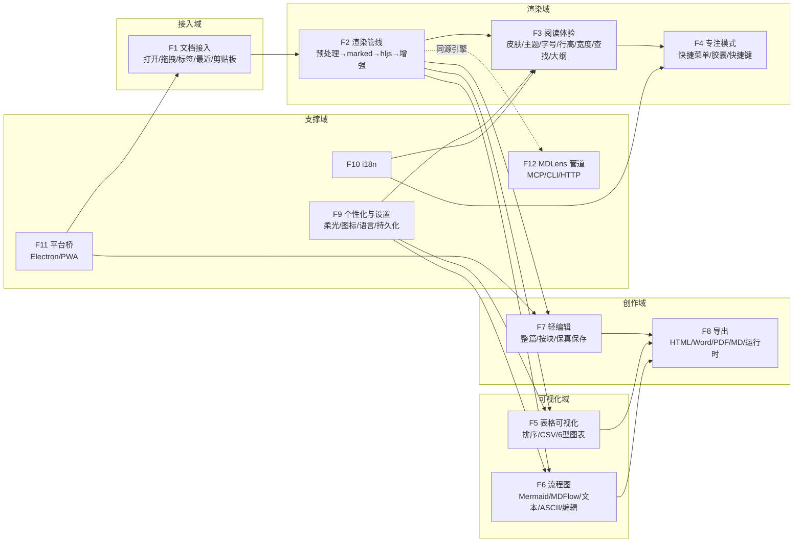
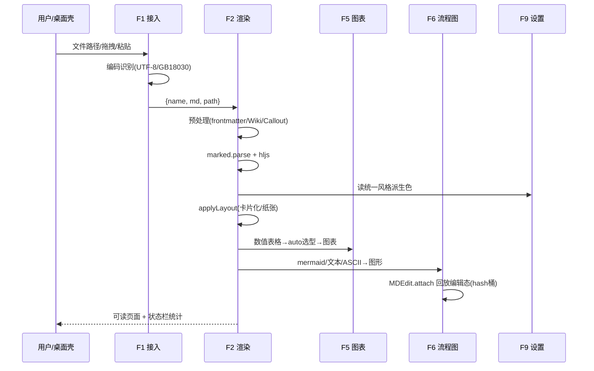
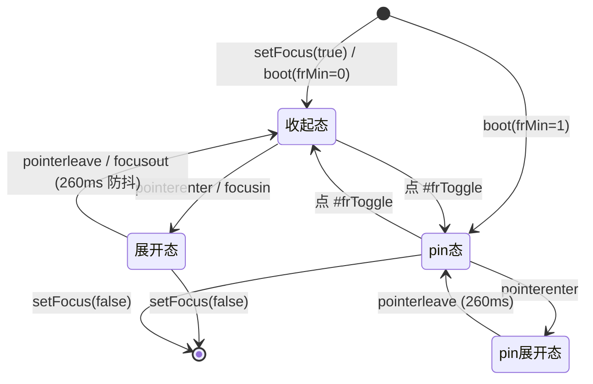

# MD Reader 功能架构设计说明

| 文档属性 | 内容 |
|---|---|
| 文档编号 | MDR-DESIGN-03 |
| 版本 | v1.0 |
| 编制日期 | 2026-11-16 |
| 适用产品版本 | MD Reader v1.7.0 + CR-2026-11-16-08 · MDLens v0.2.0 |
| 文档状态 | 评审稿 |
| 关联文档 | 01-产品设计方案 · 02-技术架构设计 · 04-分阶段交付计划 |
| 编制依据 | `src/app.js`（5510 行，分段注释为模块边界事实源）、`src/mermaid-flow.js`、`src/text-flow.js`、`src/ascii-diagram.js`、`src/export-runtime.js`、`src/i18n.js`、`mdlens/lib/mcp.js` |

---

## 1. 功能架构总图



**域划分原则**：接入域只管"内容进来"；渲染域只管"内容变页面"；可视化域只管"数据/流程变图形"；创作域只管"内容改与带走"；支撑域横切所有域。**禁止跨域直接改对方内部状态**，一律经状态中枢 `S.*` 与公开函数接口。

---

## 2. 功能模块拆解（WBS 到可测试粒度）

> 行号为 `src/app.js` 当前版本定位锚点（±20 行内），供开发快速跳转；以分段注释为准。

### F1 文档接入（L376–520、L4111–4198、L3948–4111）

| 编号 | 子功能 | 实现锚点 | 验收断言所在 |
|---|---|---|---|
| F1.1 | 打开文件（多选）/ 文件夹递归拖拽 | `loadFileList` L343；拖放 L4111（多重回退+明确报错） | test-clipboard / test-settings-ui |
| F1.2 | UTF-8/GB18030 自动识别读取 | L265 读取段；桌面走 iconv-lite | 编码样本用例 |
| F1.3 | 多标签页（每标签存 `{key,item,md,scrollTop}`） | L520 标签段 | test-cr07 |
| F1.4 | 标签右键批量关闭菜单（CR-07） | L3230 | test-cr07（178 断言） |
| F1.5 | 最近打开 + 滚动位置接力 | `loadRecent` L395；Ctrl+R | test-settings-ui |
| F1.6 | 剪贴板粘贴创建（浮层降级通道） | L2663–2936 | test-clipboard（13 断言） |
| F1.7 | 新建空白文档（内存态，Ctrl+S 另存回填路径） | L379–425 | test-clipboard |
| F1.8 | 文件树（目录分组/折叠/计数） | L426 | test-settings-ui |
| F1.9 | 桌面冷启动/第二实例文件转发 | desktop/main.js pendingFiles | 手工验收清单 |

### F2 渲染管线（L468–608）

| 编号 | 子功能 | 实现锚点 | 说明 |
|---|---|---|---|
| F2.1 | Markdown 预处理（frontmatter→属性卡、Wiki 链接、Callout、图片相对路径） | L468–518 | Wiki 链接 `encodeURIComponent`，走内部路由 |
| F2.2 | marked 渲染 + hljs 高亮 | L518 | renderer 定制注入点 |
| F2.3 | 卡片化分节（buildCards/unbuildCards）+ 字数统计 | L3916 applyLayout 联动 | 纸张模式 unbuild |
| F2.4 | 文档属性卡（title/author/version/tags…） | 预处理段 | 6 字段示例 |
| F2.5 | 统一文档风格派生色注入（mono/tech/gov/cute × 三主题） | L1308（CR-01） | test-doc-style（56 断言） |

### F3 阅读体验（L2576–2663、L1836–1889、L2169）

| 编号 | 子功能 | 锚点 | 验收 |
|---|---|---|---|
| F3.1 | 双皮肤 card/paper（applyLayout 唯一汇聚点） | L3916 | test-cr05 |
| F3.2 | 三主题 setTheme（唯一汇聚点） | L2619 | test-cr08 F3 |
| F3.3 | 字号 12–22 / 行高四档（--fs/--lh 单变量驱动） | setFont L2639 / setLineHeight L2648 | test-cr05 |
| F3.4 | 阅读宽度控制 | read-width 段 | test-read-width（56） |
| F3.5 | 全文查找（高亮+逐条跳转） | L1836 | 手工+回归 |
| F3.6 | 大纲导航（标题树+跳转） | L463 outline | test-settings-ui |
| F3.7 | 状态栏（字数/阅读时长/皮肤/主题/版本） | L2169 | 静态断言 |

### F4 专注模式（L4198–4371、L5109–5378 LP）

| 编号 | 子功能 | 锚点 | 验收 |
|---|---|---|---|
| F4.1 | 进入/退出（Ctrl+O/Esc/按钮/欢迎卡） | setFocus L4198 | test-focus-render（101） |
| F4.2 | 图标极简菜单三态（frSetOpen/frSetMin/frScheduleClose，CR-08） | L4218–4310 | test-cr08（240） |
| F4.3 | 14 代理投影 + syncFocusRender 双向闭环 | L4312–4350 | test-cr08 F2/F3 |
| F4.4 | 液态胶囊 LP（多宿主：side-tabs/set-seg/skin-switch/focusRender/chart-types/mf-modes） | LP_HOSTS L5205 | test-cr06（299） |
| F4.5 | 快捷键注册（唯一注册点，Ctrl+O 语义避让） | L3787 | test-focus-render |
| F4.6 | 阅读进度条 | updateFocusProgress | test-focus-render |

### F5 表格可视化（L957–1782）

| 编号 | 子功能 | 锚点 | 验收 |
|---|---|---|---|
| F5.1 | 表格排序/对齐/复制 CSV | L957 | test-doc-style |
| F5.2 | 6 型图表 auto/bar/line/trend/pie/rose（CHART_TYPES L26） | L1141 选型 / L1204 绘制 / L1419 bar / L1741 pie·rose | test-pie-percent（49）/ test-rose（54） |
| F5.3 | auto 智能选型（时间列→trend/bar；单系列→pie；多系列→bar） | L1150–1152 | test-rose |
| F5.4 | 图表类型手动切换条 + 总开关（chartAuto） | L1753 / syncToggles L3336 | test-cr08 F2 |
| F5.5 | 饼图百分比标注 / 玫瑰图按值升序辐射 | CR-05c | test-pie-percent / test-rose |
| F5.6 | 胶囊文字择墨（--lp-ink，对比度≥4.5） | L1230（CR-06） | test-cr06 |
| ⚠️ | **已知缺陷**：玫瑰图「合计」行计入扇区（isTotalHead L952 只过滤列头不过滤行标签） | L952 | 待修，见 04 文档 R-07 |

### F6 流程图（L1782–1836 + 三个引擎文件）

| 编号 | 子功能 | 实现 | 验收 |
|---|---|---|---|
| F6.1 | Mermaid v10 原生渲染 | L1782 | test-flow（48） |
| F6.2 | MDFlow 自研渲染（structure×style 正交；MODE_LABELS/getMode） | mermaid-flow.js（93KB） | test-flow-modes（42）/ test-flow-modes-ui（24） |
| F6.3 | 五结构 auto/pipeline/mindmap/org/timeline + 单图结构覆盖（按 src hash） | mermaid-flow.js L501 | test-flow-modes |
| F6.4 | 符号空格文本流程图转换 | text-flow.js（27KB） | test-textflow（33） |
| F6.5 | ASCII 框线图纯算法识别 | ascii-diagram.js（21KB） | test-ascii-diagram（101） |
| F6.6 | 可视化编辑 MDEdit（拖拽/改字/增删/颜色；content 按 src hash、pos 按 src hash+L.mode 分桶） | mermaid-flow.js MDEdit | test-flow-edit（108） |
| F6.7 | 一键转换总开关 flowAll + 风格切换 | syncToggles / updateFlowButton L3346 | test-cr08 F2 |

### F7 轻编辑（L1889–2169）

| 编号 | 子功能 | 锚点 | 说明 |
|---|---|---|---|
| F7.1 | 整篇源码编辑 | L1889 段 | Ctrl+E |
| F7.2 | 按块编辑（loadBlock L2005，Alt+↑/↓ 跳块） | L2085 | 只编辑单块 |
| F7.3 | 保真保存 saveCurrent（换行/frontmatter 不失真；新文档另存回填） | L2087–2169 | 桌面 md:write-file / 浏览器下载 |
| F7.4 | 未保存提醒（返回预览/关标签二次确认） | L2040 | 破坏性操作规范 |
| F7.5 | 原始节点保存/恢复（saveRawNodes L3814 / restoreRawNodes） | 编辑↔预览切换 | 防 DOM 污染 |

### F8 导出（L2186–2576 + export-runtime.js）

| 编号 | 子功能 | 锚点 | 说明 |
|---|---|---|---|
| F8.1 | cloneForExport 统一克隆管线（剥离工具层） | L2236 | MDFlow.cleanForExport |
| F8.2 | inlineVars：SVG 内 var(--mf-*) 展开为真实色值 | L2242/2261 | 新变量必须可被 cssVars() 解析 |
| F8.3 | exportHTML（自包含+导出页运行时预置 CR-04） | L2376 / L2279 | test-export-runtime（94） |
| F8.4 | exportWord（HTML+MSO .doc；流程图/图表栅格化；A4 @page；表格主题联动） | L2518 | Word/WPS 双兼容 |
| F8.5 | exportPDF（window.print，打印样式隐藏工具） | L2555 | 所见即所得 |
| F8.6 | exportMD（原文下载） | L2561 | |
| F8.7 | 导出页运行时（导出后仍可切图表/流程图/主题） | export-runtime.js（22KB） | test-export-runtime |

### F9 个性化与设置（L3358–3479、L3479–3807、L3579 syncSettingsUI）

| 编号 | 子功能 | 锚点 | 验收 |
|---|---|---|---|
| F9.1 | 设置面板（syncSettingsUI 汇聚 + 恢复默认） | L3579–3594 | test-settings-ui（56） |
| F9.2 | 云晰柔光 PM（五参数 sepia/sat/con/bri/noise；一个控件两个动作：track 切换/文字开面板） | L3479 / savePm L3408 | test-papermatte（39）/ test-pm-global（120） |
| F9.3 | 应用图标两组（minimal/cartoon）× 明暗 | setLogo L2607 | 静态断言 |
| F9.4 | 顶栏自适应（窄屏收纳） | toolbar 段 | test-toolbar-adaptive（47）/ test-toolbar-geom（24） |
| F9.5 | 偏好持久化 save/load（mdreader.* 前缀） | L251–252 | 全部 UI 测试隐式覆盖 |

### F10 i18n（L75–236 + i18n.js 34KB）

| 编号 | 子功能 | 说明 |
|---|---|---|
| F10.1 | 静态 DOM 扫描翻译（_zhEls） | 首见中文建映射 |
| F10.2 | 状态文案显式 t() 生成 | 动态文案不走扫描 |
| F10.3 | userContent() 排除规则 | **#frToggle 必须排除**（状态相关防回写）；不得排除整个 #focusRender（历史教训：8 条英文断言全破） |
| F10.4 | 构建期默认语言（MDREADER_EDITION / MDREADER_DEFAULT_LANG） | build.py |

### F11 平台桥（desktop/ + ios/）

F11.1 Electron 主进程（单实例/关联/菜单/对话框）；F11.2 preload 白名单 `__MD_DESKTOP__`；F11.3 PWA manifest+SW v22；F11.4 macOS 构建链。接口明细见 §5.2。

### F12 MDLens 管道（mdlens/lib/）

F12.1 MCP server（mcp.js，6 工具）；F12.2 HTTP+SSE（server.js/daemon.js）；F12.3 CLI（bin/mdlens.js，10 命令）；F12.4 渲染客户端（client.js/render.js，headless 复用引擎）；F12.5 doctor 自检。接口明细见 §5.3。

---

## 3. 模块边界定义

| 模块 | 拥有（可写） | 只读依赖 | 禁止事项 |
|---|---|---|---|
| F1 接入 | S.files/S.tabs/最近列表 | F11 桥 | 禁止直接触发渲染细节；只产出 `{name,md,path}` 交给 F2 |
| F2 渲染 | content DOM、S.current | F9 风格参数 | 禁止持有编辑态；渲染前必须 saveRawNodes 可恢复 |
| F3 体验 | --fs/--lh/宽度变量 | F2 DOM | 禁止改文档内容 |
| F4 专注 | focusRender 三态 class、LP 胶囊 | F9 全部状态（经 syncFocusRender 回读） | **禁止自持业务状态**——14 代理只是投影；#frToggle 不带 data-proxy |
| F5 图表 | chart-box DOM、S.chartType | F2 表格数据 | 禁止改表格原文；「合计」行过滤规则集中 isTotalHead（待修 R-07） |
| F6 流程图 | SVG host、MDEdit 桶 | 源码 hash | structure 与 style 正交：改风格不得重绘几何；改结构必须更新 L.mode |
| F7 编辑 | 编辑器 DOM、保存通道 | F2 原始节点 | 禁止绕过 saveCurrent 直写文件 |
| F8 导出 | 导出产物 | 当前 DOM 克隆 | **禁止读"渲染前源码"代替"最后编辑状态"**；必须走 clone+inlineVars+clean 三件套 |
| F9 设置 | S.* 偏好、localStorage | — | 每个 setter 必须通知全部投影（syncSettingsUI+syncFocusRender） |
| F10 i18n | 词典、DOM 文案 | 全部 UI | 状态动态文案必须排除静态扫描 |
| F11 桥 | 系统能力 | — | 禁止向渲染层透传 Node API |
| F12 管道 | 渲染产物/预览会话 | 引擎 HTML | 禁止修改引擎副本；HTTP 禁止绑定非回环地址 |

**边界仲裁规则**：出现跨域需求时，先在状态中枢加字段 + 在汇聚 setter 加同步，再让双方各自投影；任何"顺手直接改对方 DOM"的写法在评审中一票否决（CR-08 三缺陷即此类问题的历史代价）。

---

## 4. 模块依赖关系

### 4.1 依赖矩阵（行依赖列）

| ↓依赖→ | F1 | F2 | F3 | F4 | F5 | F6 | F7 | F8 | F9 | F10 | F11 |
|---|---|---|---|---|---|---|---|---|---|---|---|
| F1 | — | | | | | | | | | ● | ● |
| F2 | ● | — | | | | | | | ● | ● | |
| F3 | | ● | — | | | | | | ● | ● | |
| F4 | | | ● | — | | | | | ● | ● | |
| F5 | | ● | | | — | | | | ● | ● | |
| F6 | | ● | | | | — | | | ● | ● | |
| F7 | | ● | | | | | — | | | | ● |
| F8 | | | | | ● | ● | ● | — | ● | ● | |
| F9 | | | | | | | | | — | ● | ● |
| F12 | | ●(引擎) | | | | | | | | | |

### 4.2 关键依赖链与环检测

- 主链：`F1 → F2 → {F3,F5,F6} → F8`，单向无环。
- F4 依赖 F9 状态但**不反向写**（投影只读），避免环。
- F7 ↔ F2 通过 saveRawNodes/restoreRawNodes 快照解耦，不构成运行时环。
- **循环依赖红线**：任何新增依赖若形成环，必须经状态中枢中转。

---

## 5. 接口定义规范

### 5.1 内部函数接口（L3 公开契约，冻结项标注 🔒）

| 接口 | 签名 | 语义 | 稳定性 |
|---|---|---|---|
| save / load | `save(k:string,v:string)` / `load(k,d:string):string` | mdreader.* 持久化，静默容错 | 🔒 |
| setTheme | `setTheme(t:'light'\|'dark'\|'sepia', opts?:{quiet?:boolean})` | 主题唯一汇聚点；末尾必须 syncFocusRender+lpRefresh | 🔒 |
| applyLayout | `applyLayout(mode:'card'\|'paper', opts?:{silent?,keepFind?})` | 排版唯一汇聚点 | 🔒 |
| setLineHeight | `setLineHeight(v:'compact'\|'standard'\|'comfort'\|'loose', opts?)` | --lh 单变量 | 🔒 |
| syncFocusRender | `syncFocusRender():void` | 14 代理回读 + aria-label/aria-pressed | 🔒（代理集合冻结） |
| syncToggles | `syncToggles():void` | 三总开关汇聚（chartAuto/flowAll/pm） | 🔒 |
| frSetOpen / frSetMin | `frSetOpen(on:boolean)` / `frSetMin(on:boolean,opts?:{quiet?})` | 菜单三态；frMin 持久化 | CR-08 新增 |
| MDFlow.render | `MDFlow.render(src:string, host:Element):L` | L.mode 必须反映实际生效结构（pos 桶键） | 🔒 |
| MDFlow.inlineVars | `inlineVars(svgText:string):string` | 导出色值展开 | 🔒 |
| MDFlow.cleanForExport | `cleanForExport(clone:Element):void` | 剥离 .mf-tools/.ad-src/.ad-warn | 🔒 |
| MDEdit.attach/toggle/command | 按 src hash 回放/切换/执行编辑命令 | content/pos 分桶 | 🔒 |
| cloneForExport | `cloneForExport():Promise<Element>` | 导出统一克隆（含图片内联/图形栅格化前置） | 🔒 |
| exportHTML/Word/PDF/MD | `():Promise<void>\|void` | 四格式导出 | 🔒 |
| t | `t(zh:string):string` | 按 effLang() 翻译 | 🔒 |

**内部接口变更流程**：改 🔒 接口 = 破坏性变更，必须出变更单 + 全量回归 + 四端同步，禁止静默修改。

### 5.2 平台桥接口（`window.__MD_DESKTOP__`，Electron preload 白名单）

| 方法 | 参数 | 返回 | 错误约定 |
|---|---|---|---|
| takePending() | — | `string[]`（冷启动暂存文件） | 空数组 |
| readFile(p) | 绝对路径 | `{text,enc}` | 抛错→渲染层 toast |
| readBinary(p) / listDir(d) | 路径 | base64 / 目录条目 | 同上 |
| writeFile(p,text,enc) | | `{ok}` | 失败必须提示，不得静默 |
| saveAs(suggestName,text) | | 用户选择路径或取消 | 取消=null |
| readClipboard() | — | text | 权限失败→浮层降级 |
| openDialog(dirMode) | boolean | 路径[] | |
| setTheme(theme,logo) / setLang(lang) | | void | 壳层联动 |
| showInFolder(p) / openExternal(url) / openHelp() / appInfo() | | | openExternal 仅 http(s) |
| 事件订阅 | onOpenFiles/onOpenDir/onLayout/onReload/onShowHelp/onEdit/onSave/onNew/onNewFromClipboard | cb | 主→渲染单向 |

**规范**：新增桥方法必须同时改 main.js handle + preload 白名单 + 本表；渲染层必须 `var D=window.__MD_DESKTOP__; if(D&&D.x)` 判空降级（网页版无桥）。

### 5.3 MDLens MCP 接口（JSON-RPC 2.0 / stdio，server: mdlens v0.2.0）

| 工具 | 必填 | 关键可选参数 | 返回 |
|---|---|---|---|
| render_markdown | markdown | title, theme(light/dark/sepia, 默认 dark), layout(card/paper), doc_style(mono/tech/gov/cute, 别名 table_theme), flow_structure(auto/pipeline/mindmap/org/timeline), papermatte, chart_type(auto/bar/line/trend/pie/rose), chart_auto, width(560–1400, 默认 900), font(12–28, 默认 15), live, open, screenshot | URL + 统计（+截图路径） |
| open_preview | markdown | title/theme/flow_structure/papermatte/open(默认 true) | preview_id + live URL |
| update_preview | preview_id, markdown | append(默认 false) | 保持滚动位置刷新 |
| render_file | path | theme/flow_structure/papermatte/open/screenshot | 同 render |
| export_html | markdown | path(默认临时文件)/theme/flow_structure/papermatte | 自包含 HTML 路径 |
| inspect_markdown | markdown | — | 标题/表格/代码块/图表/阅读时长统计（不渲染） |

**错误码**：未知方法 -32601；参数校验失败 -32602；渲染失败 -32000（附 stderr 摘要）。
**HTTP**：`GET /healthz`（存活）· `POST /doc`（提交，返回 id/URL）· `GET /v/:id`（查看，SSE 刷新）· `GET /`（引擎页）。仅回环绑定。
**CLI**：`render/live/serve/stop/status/ls/html/shot/doctor/mcp`；stdin 管道 `-` 支持。

### 5.4 接口通用规范

1. **命名**：内部 camelCase；桥通道 `md:kebab-case`；MCP `snake_case`（协议惯例）。
2. **幂等**：setter 重复调用同值必须无副作用（toast 除外，quiet 可抑制）。
3. **容错**：所有持久化/桥调用 try/catch 降级，阅读主链路永不因辅助能力失败而中断。
4. **可测性**：每个公开接口必须有至少一条专项断言；🔒 接口变更必须附回归日志。

---

## 6. 核心业务流程说明

### 6.1 打开→渲染主流程



**关键约束**：渲染前 saveRawNodes；图表/流程图失败不阻断正文（try/catch 降级为源码块）。

### 6.2 设置变更→全投影同步流程（CR-08 强制闭环）

```
用户操作（顶栏/设置面板/专注菜单/快捷键/MCP 参数）
   └─► 唯一 setter（setTheme/applyLayout/syncToggles/…）
         ├─ 更新 S.* + DOM 原控件 + save()
         ├─ syncSettingsUI()（设置面板投影）
         ├─ syncFocusRender()（14 代理投影 + aria）
         ├─ lpRefresh()（胶囊重算，rAF+60ms 双保险）
         └─ rerender()（必要时按新主题重绘图表/流程图）
```

**验收**：test-cr08 F3 段按「数据源真值 vs 菜单实际态」14 项逐项比对，12 条外部路径全绿。

### 6.3 编辑→保存→导出一致性流程

```
Ctrl+E 进入编辑（整篇/按块）→ 修改 → Ctrl+S
   ├─ 已有路径：writeFile 保真写回（换行/frontmatter 不动）
   └─ 新文档：saveAs → 回填 absPath/isNew=false
导出（任意格式）：
   cloneForExport()（当前 DOM，含最后编辑状态）
   → inlineBlobImages → rasterizeFlows/Charts(Word)
   → MDFlow.cleanForExport（剥工具层）
   → inlineVars（SVG 变量展开）
   → 格式封装（HTML+runtime / MSO .doc / print / 原文）
```

### 6.4 专注模式三态状态机



**不变量**：任何态下 14 代理数量/顺序不变；pin 态 lpSync 显式跳过并清脏值；进入专注必 frSetOpen(false) 撤残留展开态。

### 6.5 MDLens 实时预览流程

```
Agent: open_preview(md) → daemon 起 headless 渲染 → 返回 preview_id + /v/:id
Agent: update_preview(id, md[, append]) → 重渲染 → SSE 推送 → 浏览器原位刷新（保持滚动）
Agent: export_html(md) → 自包含单文件 → 交付
```

---

## 7. 功能-测试追溯矩阵

| 模块 | 专项脚本 | 断言数（当前基线） |
|---|---|---|
| F1 | test-clipboard / test-cr07 / test-settings-ui | 13 / 178 / 56 |
| F2 | test-doc-style / test-read-width | 56 / 56 |
| F3+F4 | test-focus-render / test-cr05 / test-cr08 / test-toolbar-* | 101 / 61 / 240 / 47+24 |
| F5 | test-pie-percent / test-rose / test-cr06 | 49 / 54 / 299 |
| F6 | test-flow / test-flow-edit / test-flow-modes / test-flow-modes-ui / test-textflow / test-ascii-diagram | 48 / 108 / 42 / 24 / 33 / 101 |
| F8 | test-export-runtime | 94 |
| F9 | test-papermatte / test-pm-global | 39 / 120 |
| **合计** | **22 脚本** | **1843 PASS / 0 FAIL** |

**规则**：新功能必须"先有断言后有合并"；历史断言零删除零放宽；断言与新契约冲突时修实现而非改断言（等强度基线校准原则）。

---

*本文档与代码同源维护：模块边界/🔒 接口变更须先更新本文档 §3/§5，再动代码；行号锚点随大版本重构刷新。*