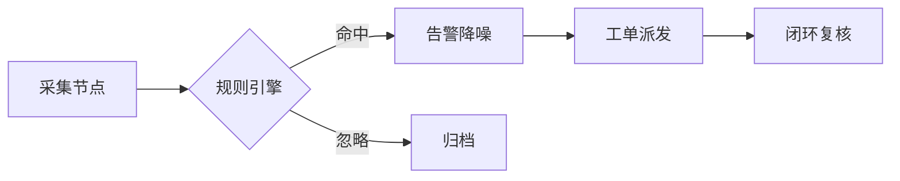

# AI 生成报告 · 2026 Q3 智能运维平台数据分析

> 本报告由 AI Agent 自动生成，原始输出为 Markdown。经 MDLens 渲染后，表格、代码与流程图均可直接阅读。

## 1. 核心指标概览

| 季度 | 采集节点(个) | 告警量(条) | 处理时长(分钟) | 闭环率 |
|---|---:|---:|---:|---:|
| 2025 Q1 | 1200 | 860 | 42 | 78% |
| 2025 Q2 | 1450 | 730 | 38 | 83% |
| 2025 Q3 | 1780 | 610 | 31 | 87% |
| 2025 Q4 | 2100 | 480 | 25 | 91% |
| 2026 Q1 | 2350 | 390 | 21 | 96% |

**结论**：告警量下降 55%，平均处理时长缩短 50%，闭环率提升至 96%。

## 2. 关键代码路径

```python
def collect_metrics(host: str) -> dict:
    """SNMP v3 采集入口：priv 加密 + 超时重试"""
    session = SnmpSession(host, version=3, security="priv")
    return session.walk(oid="1.3.6.1.2.1.1")
```

## 3. 告警处理流程



## 4. 行动建议

1. **优先扩容** Q4 采集节点，预计提升覆盖 18%
2. **迁移规则引擎** 至流式计算，降低告警延迟
3. **建立闭环看板**，按周追踪处理时长趋势
