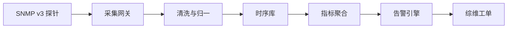

# 智慧综维平台 · 年度运行分析报告

> 报告周期：2026 年 1 月 — 12 月　|　数据来源：IPOSS 采集 + 综维工单系统

## 一、核心结论

本年度平台整体运行**平稳高效**，告警压降与工单闭环是两条主线：

1. **告警量同比下降 38.2%**，主要来自阈值优化与重复告警合并
2. **工单平均闭环时长从 4.7 小时压到 2.1 小时**，跨专业协同流程改造是关键
3. **区县覆盖率达到 100%**，曲靖 9 个区县全部接入

## 二、关键指标

| 指标 | 2025 | 2026 | 同比 |
| --- | ---: | ---: | ---: |
| 告警总量（万条） | 142.6 | 88.1 | −38.2% |
| 日均工单（单） | 386 | 412 | +6.7% |
| 平均闭环时长（h） | 4.7 | 2.1 | −55.3% |
| 一次解决率 | 71.4% | 88.9% | +17.5pp |
| 区县覆盖 | 6/9 | 9/9 | +3 |
| 采集点位 | 12,480 | 18,930 | +51.7% |

## 三、月度趋势

| 月份 | 告警量 | 工单量 | 闭环时长 |
| --- | ---: | ---: | ---: |
| 1月 | 12.4 | 386 | 4.7 |
| 2月 | 9.8 | 402 | 4.3 |
| 3月 | 8.6 | 398 | 3.9 |
| 4月 | 7.9 | 415 | 3.4 |
| 5月 | 7.2 | 421 | 3.0 |
| 6月 | 6.8 | 408 | 2.8 |

## 四、采集架构



### 3.1 协议适配

当前支持三类北向协议，南向以 SNMP 为主：

| 方向 | 协议 | 版本 | 状态 |
| --- | --- | --- | --- |
| 南向 | SNMP | v1 / v2c / v3 | 全量 |
| 南向 | NETCONF | 1.0 / 1.1 | 部分 |
| 北向 | RESTful | v2 | 全量 |
| 北向 | Kafka | 2.8+ | 全量 |
| 北向 | WebSocket | RFC 6455 | 试点 |

### 3.2 采集任务示例

```python
# 区县维度采集：按 city_code 分片，避免单次拉取过大
def collect_by_city(city_code: str, since: datetime) -> list[Metric]:
    probe = SnmpProbe(version=3, auth=("qgdjsnmp", AUTH_SHA))
    oids = load_oid_profile("county_standard")
    rows = probe.walk(oids, timeout=8.0)
    return [Metric.of(r, city=city_code, ts=since) for r in rows]
```

## 五、问题与改进

> [!WARNING]
> 三季度出现过一次采集风暴：某区县网关配置错误导致 1.2 万个点位同时重连，
> 后端聚合服务被打满，影响时长 18 分钟。已加入**连接速率限制**与**熔断**。

### 4.1 已落地改进

- [x] 采集端加入指数退避重连
- [x] 聚合服务横向扩到 4 副本
- [x] 告警去重窗口从 30s 调到 120s
- [ ] 区县网关配置的灰度下发
- [ ] 采集质量的实时看板

### 4.2 下一步

| 优先级 | 事项 | 预期收益 | 负责 |
| --- | --- | --- | --- |
| P0 | 网关配置灰度 | 杜绝采集风暴 | 网络组 |
| P0 | 采集质量看板 | 问题发现提前 4h | 平台组 |
| P1 | NETCONF 全量 | 配置类数据补齐 | 网络组 |
| P2 | 告警根因推荐 | 压降二次派单 | 算法组 |

## 六、代码片段：告警合并

```javascript
// 同一资源 + 同一指标的告警，在窗口内合并为一条，附计数
function mergeAlarms(list, windowMs = 120000) {
  const buckets = new Map();
  for (const a of list) {
    const k = `${a.resource}|${a.metric}`;
    const b = buckets.get(k);
    if (b && a.ts - b.ts <= windowMs) {
      b.count += 1;
      b.lastSeen = a.ts;
    } else {
      buckets.set(k, { ...a, count: 1, lastSeen: a.ts });
    }
  }
  return [...buckets.values()];
}
```

## 七、结论

平台已从「能采到」进入「采得准、用得上」的阶段。下一年的重点是**采集质量的可观测性**与**告警到工单的自动闭环**。